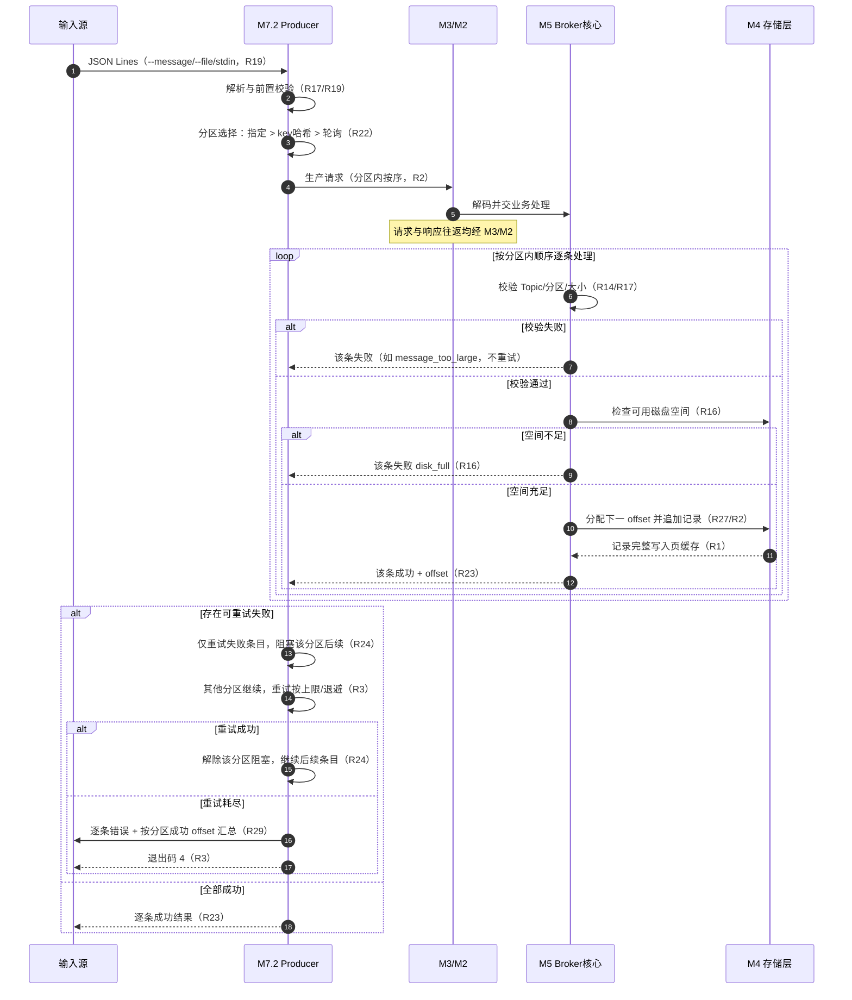
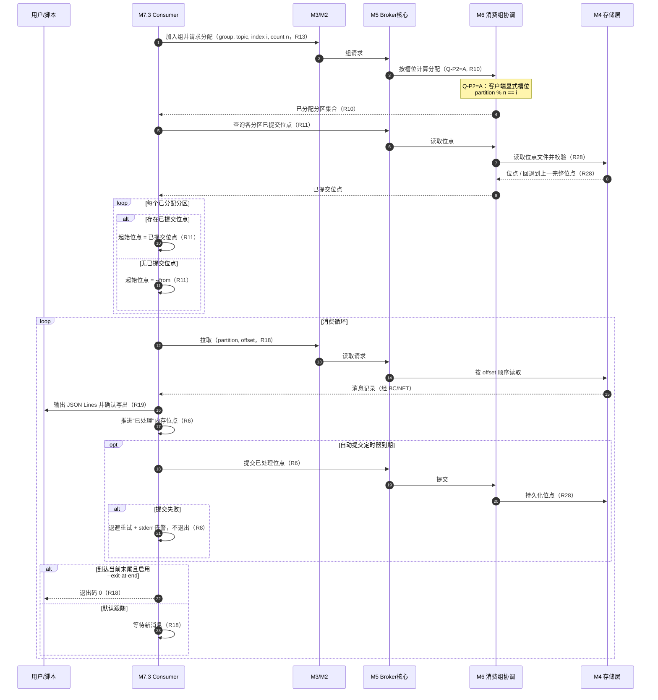
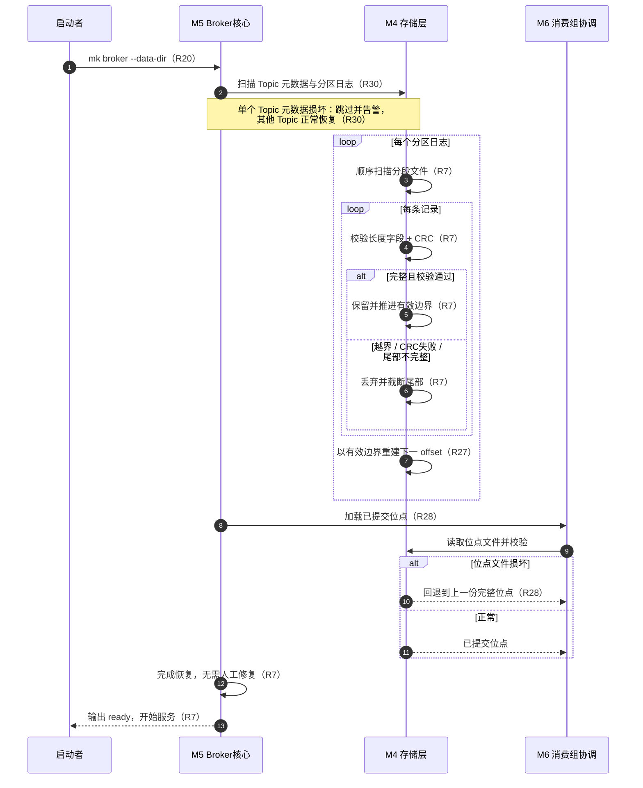

# 02-附录. 流程与故障窗口

> 隶属：`docs/design/02.功能模块梳理.md`
> 状态：**已确认 v1.0（随主文档）**
> 日期：2026-11-12
> 说明：本文件承载主文档 5.1–5.3 的流程细节与第 6 节的一致性约束/故障窗口，避免主文档体量过大。主文档保留摘要与链接。
> 依据：`docs/01.需求文档.md`（R1–R31）、`prototype/CLI交互规范.md`。

---

## A.1 一条消息从 produce 到 ack

**参与者**：输入源、M7.2 Producer、M3/M2、M5 Broker 核心、M4 存储层。

**前置条件**：Broker 已完成恢复并处于就绪状态；Topic 已存在。

**步骤**

1. Producer 从 `--message`、`--file` 或 stdin 读取输入，每行一条 JSON（R19）；解析失败或缺 `value` 不发送。
2. Producer 做前置校验：单条消息（含 key 与头信息）不超过上限（默认 1MB，Broker 可配，R17）。客户端校验仅为快速失败，权威判定在 Broker。
3. 选择目标分区：显式 `--partition` > key 哈希 > 无 key 轮询（R22）。
4. 按分区组织发送，分区内严格串行：同一分区同一时刻只允许一条消息在途；批量发送按批次整体保序（R2）。
5. Broker 逐条处理：校验 Topic/分区/大小（R14/R17）→ 主动检查磁盘可用空间（R16）→ 分配下一逻辑 offset（R27）→ 顺序追加到分区日志（R2）。
6. 记录完整写入操作系统页缓存后，Broker 对该条返回成功与 offset（R1）；空间不足或写入失败则返回该条失败，不 ack（R16）。
7. Broker 对批次内每条消息分别返回结果（R23），允许部分成功。
8. Producer 收到失败条目后：仅重试失败条目；重试期间阻塞该分区后续消息；其他分区继续发送（R24）；重试次数与总超时按配置（R3）。
9. 重试成功后解除该分区阻塞，继续后续消息；重试耗尽则输出逐条错误与按分区的成功 offset 汇总（R29），以退出码 4 结束（R3）。若仅有校验类失败，则输出汇总与退出码 3。

**关键点**

- ack 的时点是"完整记录写入页缓存"，不是"刷盘完成"（R1）；因此 `kill -9` 不丢已 ack 消息，掉电可能丢最近未刷盘消息。
- Broker 的写入顺序即分区内 offset 顺序；Producer 通过分区级阻塞重试保证"发送顺序 = 写入顺序"（R2/R24）。
- 批量是"逐条独立结果"，不是整批原子成功或失败（R23/V8）。
- 重试可能产生重复消息；至少一次语义接受重复，不做去重（R3）。

**关联验收**：V1（ack 与恢复）、V6（磁盘满）、V7（超限）、V8（批量失败）、V5（ack 延迟）、V11（分区内顺序）。

## A.2 从 fetch 到位点提交

**参与者**：用户/脚本、M7.3 Consumer、M3/M2、M5 Broker 核心、M6 消费组协调、M4 存储层。

**前置条件**：Topic 已存在；Broker 就绪；消费者以 `(group, topic)` 身份启动。

**启动阶段**

1. Consumer 加入组并请求分配（R13）。
2. Consumer 以 `--consumer-index i --consumer-count n` 提供槽位（Q-P2=A）；M6 按 `partition % n == i` 计算并校验分配：组内互不重叠；成员变化不触发 rebalance；失效槽位的分区暂停，直至同 index 重新加入（R10）。Broker 不维护组成员状态。
3. Consumer 查询各已分配分区的已提交位点（R11）。位点由 M6 维护、M4 持久化；损坏时回退到上一份完整位点（R28）。
4. 起始位点裁决（R11）：有已提交位点 → 从已提交位点继续；无已提交位点 → 按 `--from` 选择 earliest / latest / 指定位点。

**消费阶段**

5. Consumer 按分区与 offset 拉取消息（R18）。
6. 每条消息以 JSON Lines 写出到 stdout；只有成功写出后，内存中的"已处理位点"才推进（R6）。
7. 自动提交定时器到期时，把"已处理位点"提交给 Broker 并持久化（R6）。提交间隔只影响崩溃后的重复窗口，不影响正确性。
8. 提交失败：退避重试；拉取仍可用则继续消费；连接断开则持续重连；周期性向 stderr 告警；进程不主动退出（R8）。
9. 读到当前末尾时：默认进入跟随，阻塞等待新消息；带 `--exit-at-end` 时退出码 0（R18）。
10. 消费者崩溃后以同 group/topic 重启：从最后已提交位点继续；最多重复"已处理但未提交"的区间，不丢消息（R6/R11/R28）。

**关键点**

- "已处理"是提交的语义基准，不是"已拉取"（R6）。消息未成功交付前不得推进位点。
- 自动提交只减少重复窗口，不改变正确性；崩溃最多重复未提交区间（R6）。
- 已提交位点优先于 `--from`；从中间重读必须通过 replay 或新 group（R11/R12）。
- 提交失败不导致退出；消费者继续消费并持续告警（R8）。
- MVP 不做动态 rebalance；失效槽位的分区暂停，不转移给存活槽位；重新加入必须使用相同 index（Q-P2=A/R10）。

**关联验收**：V2（位点重启续消费）、V9（静态分配）、V10（replay 不影响位点）、V11（顺序）、V3（P1，不计 MVP）。

## A.3 Broker 崩溃恢复

**参与者**：启动者、M5 Broker 核心、M4 存储层、M6 消费组协调。

**前置条件**：Broker 进程此前被 `kill -9` 或异常退出；数据目录中存在分区日志与位点文件。

**步骤**

1. `mk broker --data-dir ...` 启动，M5 初始化数据目录；按 R30 扫描重建 Topic 元数据；单个元数据损坏跳过并告警，不阻止启动。
2. 对每个分区日志，M4 按顺序扫描分段文件（R7）。
3. 对每条记录按"记录长度字段 + CRC"校验（R7）：
   - 完整且校验通过 → 保留，推进有效边界；
   - 长度越界、CRC 失败或尾部不完整 → 丢弃并截断尾部。
4. **不依据是否 ack 判断保留**：校验通过的记录一律保留；已 ack 消息必然完整写入页缓存，因此必然可恢复（R1/R7）。
5. 以最后一条有效记录的边界重建"下一条可用 offset"（R27）；已写消息的 offset 不变；丢弃的残缺尾部不占用 offset。
6. M6 恢复已提交位点：M4 读取位点文件并做完整性校验；损坏则回退到上一份完整位点；不得导致 Broker 无法启动或全部位点丢失（R28）。
7. 恢复完成，无需人工修复；M5 对外进入就绪状态并开始服务（R7）。

**关键点**

- 恢复判据与 ack 解耦：是否 ack 不影响保留判断（R7）。
- 已 ack 消息必可读：ack 前记录已完整进入页缓存（R1）。
- offset 重建与记录完整性判据一致（R27）；截断的尾部记录不占用 offset。
- 位点恢复与消息恢复相互独立；位点损坏只造成回退与重复，不阻止 Broker 启动（R28）。
- Topic 元数据按 R30 持久化/扫描重建；单个损坏不阻止 Broker 启动。
- 恢复不需要人工干预（R7）。

**关联验收**：V1（进程崩溃恢复）、V2（位点恢复）。

---

## A.4 一致性约束与故障窗口

### A.4.1 模块协作必须满足的一致性约束

| 编号 | 约束 | 依据 |
| --- | --- | --- |
| I-01 | 已收到 ack ⇒ 记录完整且已进入页缓存，恢复扫描必然可读 | R1、R7 |
| I-02 | 分区内 offset 严格递增、无空洞、不复用；发送顺序 = 写入顺序 = 消费顺序 | R2、R27 |
| I-03 | 已提交位点 ≤ 已处理位点 ≤ 分区可读末尾；起始位点已提交位点优先 | R6、R11 |
| I-04 | 恢复后有效边界之前的记录均可读；校验通过的记录一律保留，与 ack 无关 | R7 |
| I-05 | MVP 客户端显式槽位下，同一 group 的同一分区只属于一个槽位/消费者；失效槽位分区暂停、不转移；重新加入必须使用相同 index（Q-P2=A） | R10 |
| I-06 | Replay 不改变任何 group 的已提交位点或消费进度 | R12 |
| I-07 | 磁盘满只影响写路径：读路径可用，Broker 进程存活 | R16 |
| I-08 | 单条超过上限必须拒绝，不得截断 | R17 |
| I-09 | 位点文件损坏不得阻止 Broker 启动，位点可回退到上一完整版本 | R28 |
| I-10 | 至少一次的承诺边界是"已收到 ack 的消息"；重复可接受、不去重 | R3 |
| I-11 | Topic 元数据必须持久化；单个元数据损坏跳过并告警，不阻止 Broker 启动；其他 Topic 正常 | R30 |

### A.4.2 故障影响与重复窗口

| 故障 | 数据影响 | 重复/丢失窗口 | 依据 |
| --- | --- | --- | --- |
| Broker `kill -9` | 已 ack 消息不丢；未 ack 但完整且校验通过的记录可能保留；残缺尾部被截断 | 未 ack 消息由 Producer 决定是否重发 | R1、R7 |
| 机器宕机/掉电 | 最近未刷盘的消息可能丢失（显式能力边界） | 允许丢失最近未刷盘消息 | R1 |
| Consumer `kill -9` | 不丢消息 | 最多重复"已处理但未提交"区间（≤ 一个提交间隔） | R6、R11 |
| 位点文件损坏 | 已提交位点回退 | 回退点之后可能重复消费 | R28 |
| Producer 重试 | 可能重复写入 | 未收到 ack 的重试条目 | R3 |
| 位点提交失败 | 不丢消息 | 未提交区间在恢复后重复 | R8 |
| 磁盘满 | 新写入被拒绝；已有数据可读 | 无（拒写，不是丢失） | R16 |
| 单个 Topic 元数据损坏 | 该 Topic 本次启动跳过并告警；其他 Topic 正常 | 该 Topic 暂不可用，修复后可恢复 | R30 |
