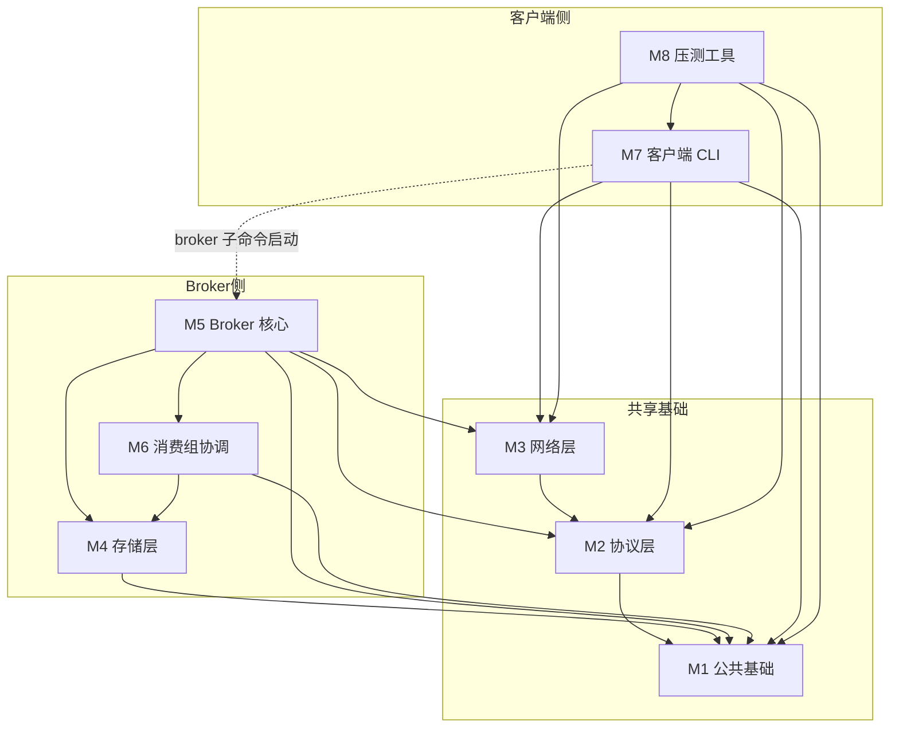

# 02. 功能模块梳理

> 项目：miniKafka（类 Kafka 消息队列，演示验证型学习项目）
> 子阶段：设计阶段 第 1 子阶段（功能模块梳理）
> 状态：**已确认 v1.0**
> 日期：2026-11-12
> 依据：`docs/01.需求文档.md`（R1–R30 为唯一需求口径）、`prototype/CLI交互规范.md`（v0.1，用于命令形态与输出约定）
> 约束：本文件不做技术选型、不设计存储格式、不设计协议报文、不写代码。
> 附录：[`02-附录.流程与故障窗口.md`](02-附录.流程与故障窗口.md)（承载 5.1–5.3 流程细节与第 6 节完整表格）。

---

## 1. 文档说明

### 1.1 本文件的目的

1. 把 R1–R30 转成**可追踪的功能项**，每条功能标注来源 R 编号。
2. 划分功能模块，明确每个模块的职责与**边界**（做什么、不做什么）。
3. 给出模块间依赖与调用关系。
4. 梳理三条核心业务流程：produce → ack、fetch → 位点提交、Broker 崩溃恢复。
5. 汇总仍不确定的需求缺口与实现细节，**留待确认，不自行决定**。

### 1.2 明确不在本文件范围

| 内容 | 归属子阶段 |
| --- | --- |
| 技术选型、I/O 与并发模型、进程/线程模型 | 03 技术选型与架构 |
| 记录格式、分段文件格式、CRC 算法、位点文件布局 | 04 存储设计 |
| 请求/响应报文、字段布局、错误码表、帧编码 | 05 协议设计 |
| 类/函数接口签名、目录结构、代码实现 | 实现阶段 |
| P1（v1.1）动态 rebalance 的详细设计 | P1，另行设计 |

### 1.3 依据与优先级

- 功能口径以需求文档第 4 节 R1–R30 为准；第 3 节仅为初始输入，不构成最终需求。
- CLI 的命令形态、输出流、错误对象形式参考 `prototype/CLI交互规范.md`；其中标注"待确认"的参数与默认值**不是已确认需求**。
- 两者冲突时以 R 系列为准。
- 需求文档第 5 节的 A/B 项、CLI 规范的 Q-P 项，以及本文件新识别的 Q-D 项，均列为待确认项，不得当作既定事实。

### 1.4 编号约定

| 前缀 | 含义 |
| --- | --- |
| `R*` | 需求文档第 4 节已确认结论 |
| `F-*` | 本文件梳理的功能项 |
| `NFR-*` | 非功能目标/约束 |
| `M*` | 功能模块 |
| `D-*` | 本阶段做出的设计取舍（已确认） |
| `Q-*` | 待确认项（需求缺口或实现细节） |
| `V*` | 需求文档第 8 节验收项 |

---

## 2. 功能清单

> 说明：下表按功能域分组。每条均标注来源 R；CLI 规范只用于补充命令形态，不新增需求。

### 2.1 Topic 与元数据

| 编号 | 功能项 | 行为与边界 | 来源 R | 所属模块 | 范围 |
| --- | --- | --- | --- | --- | --- |
| F-T01 | 创建 Topic | 指定名称与分区数（1–16）；分区数创建后不可变；同名 Topic 拒绝；名称规则待 Q-P8 | R14 | M5 / M4 / M7.1 | MVP |
| F-T02 | 列出 Topic | 每个 Topic 输出名称、分区数、分区 id 列表；无 Topic 时输出空列表 | R14 | M5 / M7.1 | MVP |
| F-T03 | 删除与扩容约束 | 不提供 Topic 删除；不提供分区增减/重映射；16 为每个 Topic 的创建上限 | R14、R21 | M5 / M7.1 | MVP（约束） |
| F-T04 | Topic 元数据跨重启保留 | 创建时持久化名称与分区数；启动扫描重建；单个元数据损坏跳过该 Topic 并告警，不得阻止 Broker 启动；具体实现方式在 04 存储设计确定 | **R30**（关联 R7、R14） | M5 / M4 | MVP |

### 2.2 生产与写入

| 编号 | 功能项 | 行为与边界 | 来源 R | 所属模块 | 范围 |
| --- | --- | --- | --- | --- | --- |
| F-W01 | 输入形态 | `--message` 单条 / `--file` JSON Lines / stdin；每行一条 JSON；输入优先级按 CLI §2.4 | R19 | M7.2 | MVP |
| F-W02 | 客户端前置校验 | 校验 JSON 必填字段与单条大小上限；超限快速失败；权威校验仍在 Broker | R17、R19 | M7.2 | MVP |
| F-W03 | 分区选择 | 显式 `--partition` > key 哈希 > 无 key 轮询；无 key 消息不保证跨分区顺序；批量指定分区语义待 Q-P13 | R22 | M7.2 | MVP |
| F-W04 | 分区内保序与串行 | 同一分区同一时刻只允许一条消息"在途"；批量发送按批次整体保序；分区之间可并行 | R2 | M7.2 / M5 | MVP |
| F-W05 | 服务端写入校验 | Topic 是否存在、分区号是否合法、单条是否超限；失败返回该条错误，不截断 | R14、R17 | M5 | MVP |
| F-W06 | 磁盘空间主动预检 | 返回 ack 前主动检查可用空间；不足时拒绝该写入并返回明确错误；不得仅依赖 `write()` 返回值 | R16 | M5 / M4 | MVP |
| F-W07 | 顺序追加与 offset 分配 | 分区内按接受顺序追加；offset 为分区内单调递增逻辑序号；成功条目返回其 offset | R2、R27 | M5 / M4 | MVP |
| F-W08 | 逐条返回结果 | 批内每条消息独立返回成功/失败；成功条目含 offset，失败条目含原因或可定位标识 | R23 | M5 / M7.2 | MVP |
| F-W09 | 分区级阻塞重试 | 某分区出现失败条目时暂停该分区后续消息；先重试失败条目；其他分区不受影响 | R24 | M7.2 | MVP |
| F-W10 | 有限重试与明确失败 | 重试次数与总超时可配；耗尽后打印明确错误（分区、消息位置、原因），非 0 退出，不静默丢弃 | R3 | M7.2 | MVP |
| F-W11 | 失败对账汇总 | 因某分区重试耗尽而退出前，输出按分区的成功条目 offset 汇总 | R29 | M7.2 | MVP |
| F-W12 | ack 持久化边界 | 完整记录写入操作系统页缓存后即 ack；不要求在 ack 路径显式磁盘同步；`kill -9` 不丢，掉电允许丢失最近未刷盘消息 | R1 | M5 / M4 | MVP（可靠性约束） |

### 2.3 消费、位点与重放

| 编号 | 功能项 | 行为与边界 | 来源 R | 所属模块 | 范围 |
| --- | --- | --- | --- | --- | --- |
| F-C01 | 组身份与单 Topic 绑定 | 以 `(group, topic)` 为消费范围；一个 group 只消费一个 Topic；位点键含 group/topic/partition | R13 | M6 / M7.3 | MVP |
| F-C02 | 启动时静态分配 | Consumer 以 `--consumer-index i --consumer-count n` 显式提供槽位，按 `partition % n == i` 分配；组内不重叠；成员加入/正常退出/崩溃均不触发 rebalance；失效槽位分区暂停直至同 index 重新加入；Broker 不维护成员状态（Q-P2=A） | R10（MVP） | M6 / M7.3 | MVP |
| F-C03 | 已提交位点优先 | 该 group 在该分区有已提交位点时，一律从已提交位点继续；`--from` 不得覆盖 | R11 | M6 / M7.3 | MVP |
| F-C04 | 无位点起始策略 | earliest / latest / 指定位点；仅在无已提交位点时生效 | R11 | M7.3 | MVP |
| F-C05 | 按 offset 拉取与输出 | 按分区与 offset 拉取；每条输出 JSON Lines，至少包含 `partition`、`offset`、`key`、`value` | R19 | M7.3 / M5 | MVP |
| F-C06 | "已处理"位点推进 | 仅当消息成功交付给应用（CLI：成功写入标准输出）后，内存中的已消费位点才推进 | R6 | M7.3 | MVP |
| F-C07 | 自动提交 | 定时将"已处理位点"持久化；间隔可配，只影响崩溃后的重复窗口 | R6 | M7.3 / M6 | MVP |
| F-C08 | 提交失败处理 | 退避重试；拉取仍可用则继续消费；连接断开则持续重连；周期性向 stderr 告警；进程不主动退出 | R8 | M7.3 | MVP |
| F-C09 | 位点文件完整性 | 位点文件与消息采用同一可靠性口径；带完整性校验；损坏时回退到上一份完整位点；不得导致 Broker 无法启动或全部位点丢失 | R28 | M6 / M4 | MVP |
| F-C10 | 跟随与读到末尾退出 | 默认跟随新消息、进程常驻；`--exit-at-end` 读到当前末尾即退出，退出码 0 | R18 | M7.3 | MVP |
| F-C11 | 只读重放 | 按 topic/partition/offset/count 读取并输出历史消息；按 offset 顺序；无副作用：不提交位点、不改变任何 group 状态 | R12 | M7.4 / M5 | MVP |
| F-C12 | 中断后重启续消费 | 消费者中断后以同 group、同 topic 重启，从最后已提交位点继续；最多重复一个自动提交间隔 | R6、R11、R28 | M7.3 / M6 | MVP |

### 2.4 恢复与可用性

| 编号 | 功能项 | 行为与边界 | 来源 R | 所属模块 | 范围 |
| --- | --- | --- | --- | --- | --- |
| F-R01 | 启动自动恢复 | Broker 启动时扫描分段文件并恢复；无需人工干预；恢复完成即对外服务 | R7 | M5 / M4 | MVP |
| F-R02 | 完整性判据与尾部截断 | 以记录长度字段 + CRC 校验为判据；校验通过的记录一律保留（与是否 ack 无关）；长度越界/CRC 失败/尾部不完整则丢弃并截断 | R7 | M4 | MVP |
| F-R03 | 下一 offset 重建 | 以最后一条有效记录的边界重建下一可用 offset；已写入消息的 offset 不因重启改变；offset 无空洞、不复用；丢弃的残缺尾部不占用 offset | R27 | M4 | MVP |
| F-R04 | 磁盘满时的读可用性 | 拒绝新写入；已有数据保持可读、可消费；Broker 进程不崩溃；释放空间后恢复写入 | R16 | M5 / M4 | MVP |
| F-R05 | 位点跨重启有效 | 已提交位点持久化；Broker 或消费者重启后仍可继续；损坏按 F-C09 回退 | R28、R11 | M6 / M4 | MVP |

### 2.5 接口、配置与交付

| 编号 | 功能项 | 行为与边界 | 来源 R | 所属模块 | 范围 |
| --- | --- | --- | --- | --- | --- |
| F-I01 | 单二进制 + 子命令 | `broker`、`topic create`、`topic list`、`produce`、`consume`、`replay`；源码内部仍按角色分层 | R15 | M7 | MVP |
| F-I02 | 命令行配置 | 所有配置由命令行参数提供；未指定时用固定默认值；不引入配置文件 | R20 | M7.1 / M1 | MVP |
| F-I03 | 输出流与格式 | stdout 输出命令结果/消息记录/逐条结果/汇总；stderr 输出生命周期事件、重试事件、错误对象；均为 JSON Lines；不输出颜色/时间戳/绝对路径/随机内容（CLI §1.3） | R19 | M7.1 / M1 | MVP |
| F-I04 | 错误对象与退出码 | 错误统一为 `{"error","message"}`；0 成功、2 用法错误、3 校验/业务错误、4 投递失败；完整码表待 Q-P9 | R3、R16、R17 | M7.1 / M2 | MVP（待确认） |
| F-I05 | 帮助 | `--help` 提供命令行使用说明 | 交付物清单 §9 | M7.1 | MVP |
| F-I06 | 不提供的命令 | 不提供 `topic delete`；不提供消费者组/位点查询命令 | R21 | M7.1 | MVP（约束） |
| F-I07 | C++ 压测工具 | 测量 Broker 总入口吞吐与 Producer ack 延迟；交付形态待 03 明确 | R9 | M8 | 验收交付 |
| F-I08 | 验收脚本 | 覆盖 V1、V2、V4–V11；固定参数、可重复执行 | R9 | 工程交付 | 验收交付 |

### 2.6 非功能目标与约束

| 编号 | 目标/约束 | 口径 | 来源 R |
| --- | --- | --- | --- |
| NFR-01 | Broker 总入口吞吐 | ≥ 10 万条/秒；多 Producer 并发、消息跨多分区、纯写场景 | R5、R9、R26 |
| NFR-02 | Producer ack 延迟 | 单条或单批 send → ack 的 P99 < 10ms | R4、R9 |
| NFR-03 | 固定负载 | payload 100 字节 + key 8 字节；协议头不计入该 100 字节 | R26 |
| NFR-04 | 基准环境与可复现 | 固定基准机（虚拟机，具体配置待 A1）；同一脚本、固定参数运行；未达标以实测值如实记录 | R9、A1 |
| NFR-05 | 平台与依赖 | C++11/14、仅 Linux、CMake；禁止 boost/gRPC/现成网络库或 MQ 库；压测工具必须 C++ | 需求 §6、R9 |
| NFR-06 | 单机单 Broker 范围 | 无分区副本/Raft；数据只增不删 | R25 |

### 2.7 P1（v1.1 可选）范围占位

> 以下不计入 MVP 验收，模块设计只需保留边界；实现细节另行讨论。

| 编号 | 功能项 | 行为与边界 | 来源 R | 所属模块 | 范围 |
| --- | --- | --- | --- | --- | --- |
| P1-01 | 动态 rebalance | 成员加入、正常退出、心跳超时触发；存活成员接管失效成员的分区；同一分区不出现双消费者 | R10（P1） | M6 / M7.3 | P1 |
| P1-02 | 心跳、会话与分配算法 | 心跳间隔、会话超时、暂停策略、分配算法待 B6 | R10、B6 | M6 | P1 |

### 2.8 明确排除项

| 排除项 | 依据 |
| --- | --- |
| 消息保留期清理 | R25 |
| 分区副本 / Raft | R25 |
| ACL 安全 | R25 |
| Web 管理界面 | R25 |
| Topic 删除 / 分区扩容与重映射 | R21、R14 |
| 消费者组/位点查询命令、位点重置 | R21、R12 |
| 配置文件 | R20 |
| 跨 Topic 聚合消费 | R13 |
| 掉电零丢失 | R1 |
| 消息去重 | R3、R6 |
| P1 动态 rebalance 的 MVP 验收 | R10 |

### 2.9 R 覆盖索引

| R | 本文件落点 |
| --- | --- |
| R1 | F-W12、F-R02（恢复判据与 ack 无关）、第 6 节故障窗口 |
| R2 | F-W04、F-W07、F-W09、F-C11 |
| R3 | F-W10、F-I04、第 6 节故障窗口 |
| R4 | NFR-02 |
| R5 | NFR-01、NFR-03 |
| R6 | F-C06、F-C07、F-C12 |
| R7 | F-R01、F-R02 |
| R8 | F-C08 |
| R9 | NFR-01、NFR-02、NFR-04、F-I07、F-I08 |
| R10 | F-C02、P1-01、P1-02 |
| R11 | F-C03、F-C04、F-C12、F-R05 |
| R12 | F-C11、2.8 排除项 |
| R13 | F-C01 |
| R14 | F-T01、F-T02、F-T03、F-W05 |
| R15 | F-I01 |
| R16 | F-W06、F-R04 |
| R17 | F-W02、F-W05 |
| R18 | F-C10 |
| R19 | F-W01、F-C05、F-I03 |
| R20 | F-I02 |
| R21 | F-T03、F-I06、2.8 排除项 |
| R22 | F-W03 |
| R23 | F-W08 |
| R24 | F-W09 |
| R25 | 2.8 排除项、NFR-06 |
| R26 | NFR-03、NFR-01 |
| R27 | F-W07、F-R03 |
| R28 | F-C09、F-R05 |
| R29 | F-W11 |
| R30 | F-T04、8.1/8.3（Q-D1 关闭）、附录 A.3/A.4（I-11） |

---

## 3. 功能模块划分

### 3.1 模块总览

| 编号 | 模块 | 一句话职责 | 部署角色 |
| --- | --- | --- | --- |
| M1 | 公共基础 | 无业务语义的基础类型、错误模型、JSON、参数、时钟、哈希等 | 共享 |
| M2 | 协议层 | 客户端与 Broker 的逻辑请求/响应模型与帧编解码 | 共享 |
| M3 | 网络层 | TCP 连接管理与字节收发，连接生命周期 | 共享 |
| M4 | 存储层 | 分区消息日志与位点文件的物理读写、恢复扫描 | Broker |
| M5 | Broker 核心 | Topic/分区管理、读写路径编排、恢复编排 | Broker |
| M6 | 消费组协调 | 组身份、静态分区分配、已提交位点 | Broker |
| M7 | 客户端 CLI | 子命令入口，Producer / Consumer / Replay 客户端 | 客户端 |
| M8 | 压测工具 | 吞吐与 ack 延迟测量（辅助交付） | 验收 |

> M2、M3 是 Broker 与客户端共享的代码模块，但运行时两侧的连接与状态彼此独立（详见 4.2）。
> M8 不属于 Broker 运行路径，其交付形态（独立可执行或子命令）在 03 阶段确定。

### 3.2 M1 公共基础

**职责**

- 领域基础类型与常量：Topic 名、分区号、offset、group 名、消息记录、错误对象。
- 错误分类与错误码的基础定义（完整协议错误码表属 05 协议设计）。
- JSON Lines 编解码：逐行解析、输出序列化、必填字段校验的基础能力（R19）；value 的字符/编码边界待 Q-P14。
- 命令行参数解析通用能力与固定默认值常量表（R20；具体参数名与默认值待 B4/Q-P1–Q-P14）。
- 时钟、退避/重试计数、统一事件输出（stdout/stderr 分流）等无业务语义工具。
- 按键分区哈希能力（算法与跨进程/跨版本稳定性要求待 B1）。

**明确不负责**

- 业务校验（Topic 是否存在、分区号范围、重复 Topic）。
- 存储 I/O、网络收发、组分配与位点语义、协议报文定义。

**依赖 / 被依赖**：不依赖任何业务模块；被 M2–M8 依赖。

**关联**：R19、R20；B1、B4、Q-P8、Q-P9、Q-P14。

### 3.3 M2 协议层

**职责**

- 定义客户端与 Broker 之间的**逻辑**请求/响应模型：生产、读取、Topic 创建/列表、组分配、位点查询与提交等。具体报文集合与字段布局在 05 协议设计阶段定稿。
- 帧编解码：长度前缀拆包、CRC 校验、字节序与帧完整性检测（按协议设计规则；具体格式属 05）。
- 请求/响应与 M1 错误模型之间的映射。

**明确不负责**

- socket 收发与连接生命周期（M3）。
- 业务校验、分区选择、重试策略、存储读写（M5/M7）。
- 定义具体报文编号、字段、错误码表（05 阶段）。

**依赖 / 被依赖**：依赖 M1；被 M3、M5、M7、M8 使用。

**关联**：R1、R3、R16、R17、R19、R23。

### 3.4 M3 网络层

**职责**

- Broker 侧：端口监听、接受连接、连接生命周期管理、字节收发；把完整帧交给 M2 解码；把解码后的请求交给 M5 注册的处理器；把响应写回连接。
- 客户端侧：建立连接、请求发送、响应接收、超时检测、断线通知。
- 连接级缓冲与并发承载。具体 I/O 模型（是否多线程、事件驱动方式等）属 03 技术选型。

**明确不负责**

- 业务语义与协议字段含义。
- 重试策略（R3/R8 的重试与告警由 M7 的业务逻辑决定）。
- 持久化。

**依赖 / 被依赖**：依赖 M1、M2；被 M5、M7、M8 使用。

**边界说明**：Broker 侧采用控制反转——M3 持有 M5 注册的请求处理器，编译期依赖方向仍是 M5 → M3，不形成 M3 → M5 的反向依赖。

**关联**：R7（恢复完成前不对外服务）、R15、R18（连接保持）、R8（断连通知）。

### 3.5 M4 存储层

**职责**

- 分区消息日志：按分区管理 commit log；顺序追加记录；按 offset 读取；查询分区日志末尾 offset。
- 分段文件管理：分段组织与滚动（分段大小等参数待 B5）。
- 记录格式与恢复：长度字段、CRC、记录布局（B2）；启动扫描、逐条校验、尾部截断；以有效边界重建下一 offset（R7/R27）。
- 磁盘可用空间查询（安全阈值策略由 M5 决定，阈值本身待 Q-P11）。
- 位点文件的物理持久化：写入、完整性校验、回退到上一份完整位点（B3/R28）。
- Topic 元数据的持久化原语：创建时持久化名称与分区数、启动扫描重建、单个损坏跳过并告警（R30；具体格式/校验待 04 存储设计）。

**明确不负责**

- Topic 业务规则（名称校验、重复判断、分区数上限）。
- 消费组分配语义与位点业务规则。
- 客户端重试、协议编解码。

**依赖 / 被依赖**：依赖 M1；被 M5、M6 使用。

**关联**：R1、R2、R7、R16、R27、R28、R30；B2、B3、B5、Q-P11。

### 3.6 M5 Broker 核心

**职责**

- 启动编排：初始化数据目录、扫描重建 Topic 元数据（R30）、触发 M4 扫描恢复、确定就绪时机（R7）。
- Topic 管理：创建（名称/分区数/重复校验）、列表（R14）；不提供删除与扩容。名称规则待 Q-P8。
- 写入路径编排：服务端校验（R14/R17）→ 磁盘空间预检（R16）→ 调用 M4 分配 offset 并追加（R2/R27）→ 生成逐条结果（R23）→ 按 R1 的时点 ack。
- 读取路径编排：按 offset 读取消息（consume 与 replay 共用）；返回分区日志末尾 offset（支撑 latest、跟随即末尾等待、`--exit-at-end`）。
- 组请求路由：组分配、位点查询/提交交给 M6，不自行实现组语义。
- 磁盘满策略：拒写、保持读可用、进程存活（R16）。

**明确不负责**

- 帧编解码、socket 收发（M2/M3）。
- 客户端的输入解析、分区选择、重试/阻塞、对账汇总（M7）。
- 位点文件格式与消息日志格式（M4）。
- P1 动态 rebalance 的心跳/会话/接管细节（M6/P1）。

**依赖 / 被依赖**：依赖 M3、M2、M4、M6、M1；由 M7.5（`broker` 子命令）启动。

**关联**：R1、R2、R7、R14、R16、R17、R23、R27、R30；Q-P8、Q-P11。

### 3.7 M6 消费组协调

**职责**

- 组身份与 `(group, topic)` 绑定，保证一个 group 只服务一个 Topic（R13）；MVP 不维护成员状态（Q-P2=A）。
- MVP 静态分区分配（Q-P2=A）：Consumer 启动时通过 `--consumer-index i --consumer-count n` 提供槽位；M6 按 `partition % n == i` 计算并校验分配，保证互不重叠；Broker 不维护组成员状态；成员加入/退出/崩溃均不重分配；失效槽位负责的分区暂停消费，直至同一 index 重新加入。
- 已提交位点：读取（R11）、提交、经 M4 持久化（R28）、损坏时回退到上一份完整位点。
- 向 M7.3 提供已分配分区与已提交位点；向 M5 提供组侧状态。
- P1 扩展边界（Q-D2 已裁决）：M6 内部仅抽出可替换的分配策略边界，不引入心跳、会话、成员状态接口；P1 另行设计（B6）。

**明确不负责**

- 读取消息日志、写入消息、拉取循环（M5/M7.3）。
- 客户端的自动提交定时器、提交失败重试与告警（M7.3）。
- 消费者组/已提交位点查询命令（R21 明确不提供）。
- 直接持有网络连接；所有交互经 M5 路由。

**依赖 / 被依赖**：依赖 M4、M1；被 M5 调用；与 M7.3 通过逻辑请求交互（经 M5/M3/M2）。

**关联**：R6、R10、R11、R13、R28；Q-P2=A、Q-D2（最小预留）、B6。

### 3.8 M7 客户端 CLI

M7 是统一入口，内部按角色拆分，避免"单二进制"变成"耦合"（R15）。

#### M7.1 命令分派与参数

- 解析子命令与参数、应用默认值、处理用法错误、映射退出码、分离 stdout/stderr、提供 `--help`（R15、R19、R20）。
- 不实现 Producer/Consumer/Replay 的业务逻辑。

#### M7.2 Producer 客户端

- 输入读取：`--message` / `--file` / stdin，逐行解析 JSON（R19）。
- 客户端前置校验：必填字段与单条大小上限（R17）；权威校验在 M5。
- 分区选择：显式 > key 哈希 > 轮询（R22）；批量组织与分区内串行/保序（R2）。
- 发送与逐条结果处理（R23）。
- 失败条目重试、分区级阻塞（R24）、重试次数/总超时（R3）。
- 重试耗尽的逐条错误与成功 offset 汇总、退出码（R29/R3）。

#### M7.3 Consumer 客户端

- 启动参数：`--consumer-index i --consumer-count n`；校验 `0 <= i < n`，重新加入必须使用相同 index（Q-P2=A）。
- 加入组、按槽位获取分配（R10/R13）；Broker 不维护成员状态。
- 起始位点裁决（R11）：有已提交位点优先，否则按 `--from`。
- 拉取循环、输出 JSON Lines、写出成功后推进内存"已处理位点"（R6/R19）。
- 自动提交定时器（R6）；提交失败退避重试、告警、断线重连、不主动退出（R8）。
- 跟随模式与 `--exit-at-end`（R18）。

#### M7.4 Replay 客户端

- 按 topic/partition/offset/count 只读读取并输出（R12）。
- 不加入组、不提交位点、不改变任何 group 状态。

#### M7.5 Broker 启动入口

- 解析 `broker` 子命令参数并启动 M5（R15/R20）。

**明确不负责**

- 直接访问 M4 的日志/位点文件；所有服务端能力经 M2/M3 的逻辑请求完成。
- 复制 M5/M6 的业务规则。
- 帧编解码（M2）。

**依赖 / 被依赖**：依赖 M3、M2、M1；M7.5 依赖 M5；M8 复用 M7.2 的发送逻辑。

**关联**：R2、R3、R6、R8、R10、R11、R12、R13、R15、R17–R24、R29；B4、Q-P1–Q-P14。

### 3.9 M8 压测工具（辅助交付）

**职责**

- 吞吐压测：多 Producer 并发、消息跨多分区、纯写场景，固定 payload 100B + key 8B（R5/R26）。
- ack 延迟测量：单条/批量的 send → ack 延迟，输出 P99（R4）。
- 固定参数、可重复运行、如实记录实测值（R9/NFR-04）。
- 复用 M7.2 的发送编排能力与 M3/M2 通信能力。

**明确不负责**

- 产品功能；不改变 Broker 行为。
- 端到端投递延迟的硬指标（R4 明确不纳入验收）。

**依赖 / 被依赖**：依赖 M7.2、M3、M2、M1。

**关联**：R4、R5、R9、R26；A1。

### 3.10 模块边界规则

1. **单向依赖**：M7/M5 → M3 → M2 → M1；M5 → M4；M6 → M4。禁止反向或环形依赖。
2. **无业务规则的基础层**：M1、M2、M4 不包含 Topic/组/位点等业务规则。
3. **M5 是 Broker 侧唯一编排者**：写路径、读路径、恢复、请求路由均由 M5 编排。
4. **M6 不直接读消息日志**：只负责组与位点；分区数由 M5 作为调用参数传入，避免 M6 → M5 的反向依赖。
5. **客户端不直连存储**：M7 不得直接访问 M4；所有服务端能力必须经网络与协议完成。
6. **控制反转**：M3 持有 M5 注册的请求处理器；编译依赖保持 M5 → M3。
7. **单二进制不改变分层**：打包为一个可执行文件不构成模块间直接耦合的理由（R15）。
8. **Broker 与客户端的运行时隔离**：生产/消费/回放子命令与 `broker` 子命令是不同进程，运行时只通过 TCP 交互；共享的是代码模块，不是进程内状态。

---

## 4. 模块依赖与调用关系

### 4.1 模块依赖图

> 箭头表示"调用/依赖"。虚线表示 `mk broker` 子命令启动 M5 的启动关系，不是 Broker 业务对客户端的依赖。

### 4.2 依赖规则与理由

| 规则 | 理由 |
| --- | --- |
| M1 不依赖任何业务模块 | 保持基础类型、错误模型、JSON、参数工具可被所有角色复用 |
| M2 不依赖 M3/M4/M5/M6/M7 | 协议编解码只处理字节与逻辑消息，不感知 socket、存储与业务 |
| M3 不包含业务规则 | 网络层可同时服务 Broker 与客户端，避免两侧逻辑分叉 |
| M4 不依赖 M5/M6/M7 | 存储层只提供日志与文件原语，业务策略在上层 |
| M5 是 Broker 侧唯一编排者 | 保证写路径、读路径、恢复顺序有单一决策点 |
| M6 不依赖 M5 | 避免环依赖；M5 调用 M6 时传入分区数等上下文 |
| M7 不依赖 M4 | 强制客户端/服务端边界，保证协议是可替换的契约 |
| M8 依赖 M7.2/M3/M2 | 压测使用与生产客户端相同的发送路径，避免"测的不是真实链路" |

### 4.3 关键调用关系

| 场景 | 调用链 |
| --- | --- |
| Topic 创建/列表 | M7.1 → M3/M2 → M5 → M4（元数据持久化，R30） |
| 生产消息 | M7.2 → M3/M2 → M5 → M4（写日志）；失败重试逻辑留在 M7.2 |
| 消费拉取 | M7.3 → M3/M2 → M5 → M4（按 offset 读日志） |
| 组分配/位点查询/提交 | M7.3 → M3/M2 → M5 → M6 → M4（位点文件） |
| 只读回放 | M7.4 → M3/M2 → M5 → M4（不经过 M6） |
| Broker 启动恢复 | M7.5 → M5 → M4（消息日志扫描/截断/offset 重建）；M5 → M6 → M4（位点恢复） |
| 吞吐/延迟压测 | M8 → M7.2 → M3/M2 → M5 → M4 |

---

## 5. 核心业务流程（摘要）

> 完整步骤与 Mermaid 时序图见 [`02-附录.流程与故障窗口.md`](02-附录.流程与故障窗口.md) 的 A.1–A.3。

### 5.1 一条消息从 produce 到 ack（摘要）

- Producer 读取 JSON Lines，按“指定分区 > key 哈希 > 轮询”选择分区，并按分区串行发送（R19/R22/R2）。
- Broker 逐条校验、在追加前主动检查磁盘空间（R16），分配逻辑 offset 后追加到页缓存；**记录完整写入页缓存后 ack**，不等待 fsync（R1）。
- 批内逐条返回结果（R23）；失败条目由 Producer 仅重试失败项，期间阻塞该分区、其他分区继续（R24），耗尽后输出成功 offset 汇总并非 0 退出（R29/R3）。
- 详见附录 A.1。

### 5.2 从 fetch 到位点提交（摘要）

- Consumer 以客户端显式槽位加入组（Q-P2=A），获取静态分配与已提交位点；起始位点按“已提交位点优先，否则 `--from`”裁决（R10/R11）。
- 拉取消息后输出 JSON Lines；**仅成功写出后推进“已处理位点”**（R6）；定时提交，失败退避重试并告警、不退出（R8）。
- Broker 侧位点文件带完整性校验，损坏回退上一完整位点（R28）；崩溃重启最多重复未提交区间。
- 详见附录 A.2。

### 5.3 Broker 崩溃恢复（摘要）

- Broker 启动时先恢复再对外服务：扫描分区日志，按“长度字段 + CRC”保留有效记录、截断残缺尾部（R7）。
- 以最后有效记录边界重建下一 offset（R27）；Topic 元数据按 R30 持久化/扫描重建，单个损坏跳过并告警。
- 位点文件损坏回退上一完整位点，不阻止启动（R28）；恢复无需人工干预（R7）。
- 详见附录 A.3。

### 5.4 补充：MVP 静态分区分配与失效行为

- **客户端显式槽位（Q-P2=A）**：Consumer 启动时传 `--consumer-index i --consumer-count n`；M6 按 `partition % n == i` 计算并校验分配，组内互不重叠。
- **Broker 不维护成员状态**：不注册成员、不保存分配结果；只持久化已提交位点（D-03）。
- **不重分配**：成员加入、正常退出、崩溃均不触发 rebalance（R10）。
- **失效暂停**：某槽位无消费者时，其负责的分区暂停消费，不转移给存活槽位；重新加入必须使用相同 index，直至该 index 恢复（R10）。
- **P1 才能接管**：动态 rebalance、心跳、会话超时与故障接管均为 P1（R10/B6），不计入 MVP 验收（V3 不计 MVP 门禁）。

### 5.5 补充：只读回放

- Replay 按 `topic + partition + offset + count` 读取历史消息并逐行输出（R12）。
- 不加入 Consumer Group，不经过 M6，不提交位点，不改变任何 group 状态（R12）。
- 与 consume 共用 M5 的读取路径与消息输出格式（R19），但消费进度完全隔离。
- “无组只读访问”作为 05 协议设计输入（D-06）；对应验收 V10。

---

## 6. 一致性约束与故障窗口（摘要）

完整的一致性约束 I-01–I-11 与故障影响/重复窗口表见 [`02-附录.流程与故障窗口.md`](02-附录.流程与故障窗口.md) 的 A.4。

核心约束不变：已 ack ⇒ 页缓存完整可恢复；分区内 offset 严格递增且发送顺序 = 写入顺序 = 消费顺序；已提交位点 ≤ 已处理位点；恢复按长度 + CRC 保留有效记录；Replay 无副作用；磁盘满只影响写；Topic 元数据按 R30 持久化且单个损坏不阻止启动。

---

## 7. 本阶段设计取舍（已确认）

> 以下 D-01–D-08 已由用户确认。其中 D-03 按 Q-P2=A 改写；D-06 的“无组只读访问”记入 05 协议设计输入清单。

| 编号 | 取舍 | 理由 | 影响 |
| --- | --- | --- | --- |
| D-01 | **起始位点裁决放在 Consumer 客户端（M7.3）**：M6 提供已提交位点，M5 提供分区日志末尾位点，M7.3 按 R11 的优先级选择起始位置 | `--from` 是客户端参数；协调者保持"只维护组状态"的职责 | 若改为服务端裁决，M6/M5 接口与协议请求会变化；R11 的强制执行点也会变化 |
| D-02 | **分区级阻塞重试完全在 Producer 客户端（M7.2）**；Broker 不维护"分区阻塞"状态 | R24 是发送顺序约束；Broker 只负责按接受顺序追加 | Broker 保持无客户端状态；重试语义集中在 M7.2 |
| D-03 | **MVP 采用客户端显式槽位（Q-P2=A）**：Consumer 启动时传 `--consumer-index i --consumer-count n`，按 `partition % n == i` 计算分配；Broker 不维护组成员状态，只持久化已提交位点；成员失效时该槽位分区暂停、不转移；重新加入必须使用相同 index | 保持 MVP 简单、无需成员状态持久化；与 R10 的静态分配/失效暂停一致 | M6 只负责按槽位计算与校验分配；P1 若改用 Broker 侧注册（B 方向），另行设计 |
| D-04 | **恢复编排在 M5，扫描/截断/offset 重建在 M4**；M5 决定何时对外就绪 | 存储层只提供原语，Broker 核心掌握启动顺序 | 恢复日志与就绪事件的输出位置在 M5 |
| D-05 | **M2/M3 是共享代码，但 Broker 与客户端运行时连接/状态分离** | 满足 R15"单二进制不分层耦合"；两侧复用编解码与收发能力 | 共享层不得持有业务或连接全局状态 |
| D-06 | **Replay 复用 M5 读路径，不经过 M6** | R12 要求无副作用；绕开组协调是最直接的隔离 | 读取协议需支持“无组”的只读访问；已记入 05 协议设计输入清单 |
| D-07 | **M6 独立成模块；MVP 仅在 M6 内部抽出可替换的分配策略边界**，不引入心跳/会话/成员状态接口；P1 另行设计 | Q-D2 已裁决为最小预留；避免过度设计 | P1 需要成员管理时再扩展，不在 MVP 预埋接口 |
| D-08 | **M8 复用 M7.2 的发送编排**，但独立于产品运行路径 | R9 要求压测与真实写入链路一致；复用避免压测结果失真 | 压测工具的交付形态（独立可执行/子命令）待 03 决定 |

---

## 8. 待确认项

### 8.1 需求文档已登记的待确认项

> R30 已补入 `docs/01.需求文档.md`，Q-D1 关闭（见 8.3）。
> 除已裁决项外，A1、B1–B6 统一移交 **03 技术选型与架构** 裁决；下表“需在何处定”标注归属。

| 编号 | 问题 | 来源 | 影响模块 | 需在何处定 | 说明 |
| --- | --- | --- | --- | --- | --- |
| A1 | 基准机的具体配置（CPU 核数/内存/磁盘类型） | 需求 §5 A | M8、验收 | 03（待你提供配置） | 阻塞性能验收，不阻塞设计 |
| B1 | 按键哈希算法与跨进程/跨版本稳定性要求 | 需求 §5 B | M7.2、M1 | 03 | 决定同 key 的分区归属；也是 V11 的稳定前提 |
| B2 | 记录长度字段、CRC 算法与分段文件格式 | 需求 §5 B | M4 | 03（可由 03 下放 04） | 恢复判据的实现基础 |
| B3 | 位点文件的校验方式与"上一份完整位点"的保留策略 | 需求 §5 B | M4、M6 | 03（可由 03 下放 04） | 建议同时明确"无任何完整副本时"的处理 |
| B4 | 各命令的具体参数命名与默认值 | 需求 §5 B | M7、M1 | 03 | CLI 规范中的默认值均为原型暂定值 |
| B5 | 分段文件大小、批量上限等实现参数 | 需求 §5 B | M4、M5/M2 | 03（可由 03 下放 04/05） | 需求未约束，但影响性能与协议上限 |
| B6 | P1 动态 rebalance 的心跳间隔、会话超时、暂停策略与分配算法 | 需求 §5 B | M6、M7.3 | 03（P1 实现另行设计） | 不影响 MVP |

### 8.2 CLI 原型遗留的待确认项

> 来源：`prototype/CLI交互规范.md` §6。以下默认值只是原型暂定，不是已确认需求。
> Q-P2 已裁决为 A；其余 Q-P1、Q-P3–Q-P14 统一移交 **03 技术选型与架构** 裁决。

| 编号 | 问题 | 影响模块 | 需在何处定 |
| --- | --- | --- | --- |
| Q-P1 | `--from` 默认值：earliest 还是 latest？ | M7.3 | 03 |
| **Q-P2** | **MVP 静态分配下，消费者如何得知组内成员数与自己的分区？** | **M6、M7.3** | **已裁决：A（客户端显式槽位）** |
| Q-P3 | `--retries` 默认次数、退避间隔与总超时如何定？ | M7.2 | 03 |
| Q-P4 | 自动提交间隔默认值？ | M7.3 | 03 |
| Q-P5 | 按键哈希算法（与 B1 重复，合并处理） | M7.2、M1 | 03（并入 B1） |
| Q-P6 | 消费者正常退出（Ctrl+C / 读到末尾）时是否强制提交一次？ | M7.3、M6 | 03 |
| Q-P7 | `--from <n>` 与 `--offset <n>` 的合法边界：等于末尾是否允许？超过末尾如何提示？ | M7.3、M7.4、M5 | 03 |
| Q-P8 | Topic 名称规则、长度上限、保留字 | M5、M7.1 | 03 |
| Q-P9 | 错误码/退出码体系统一约定 | M1、M2、M7.1 | 03 |
| Q-P10 | `mk broker` 最终是前台常驻还是后台 daemon？默认端口/数据目录？ | M7.5、M5 | 03 |
| Q-P11 | R16 的"磁盘安全阈值"具体是多少？ | M5、M4 | 03 |
| Q-P12 | R29 的对账汇总输出到 stdout 还是 stderr、用什么格式？ | M7.2 | 03 |
| Q-P13 | `produce --partition` 作用于批量时，是否所有条目都写指定分区？ | M7.2 | 03 |
| Q-P14 | R19 的 value 是否只支持 UTF-8 文本？是否需要 base64/二进制与转义规则？ | M1、M7.2 | 03 |

**Q-P2 已裁决：采用 A（客户端显式槽位）。**

- Consumer 启动参数：`--consumer-index i --consumer-count n`；分配规则：`partition % n == i`。
- Broker 侧不维护组成员状态；成员失效时该槽位分区暂停、不转移；重新加入必须使用相同 index。
- B（Broker 侧组注册/分配）留作 P1 方向；C（环境变量/外部约定）因与 R20 冲突排除。
- 参数校验与最终命名/默认值归 B4，由 03 统一裁决。

### 8.3 本阶段新识别的待确认项

| 编号 | 问题 | 为何重要 | 影响模块 | 建议处理 |
| --- | --- | --- | --- | --- |
| Q-D1 | **Topic 元数据是否持久化、如何持久化、损坏时如何处理？** | 需求隐含 Broker 重启后 Topic 与分区仍可用（V1 需要读取/回放），但 R 系列未规定元数据的存储与损坏处理；这是恢复流程的必要输入 | M5、M4 | **已关闭：R30**（实现方式在 04 存储设计定） |
| Q-D2 | **MVP 的组协调接口是否为 P1 rebalance 预留扩展点？预留到什么程度？** | R10 只给 P1 功能，不规定 MVP 代码是否要为心跳、会话、可替换分配器预留接口；预留过度会增加 MVP 复杂度，完全不预留会导致 P1 重构 | M6、M7.3 | **已裁决：最小预留**（D-07） |
| Q-D3 | **Consumer 正常退出时是否补一次提交？**（与 Q-P6 同源） | 影响重复窗口与演示结果；R6 只规定"处理后推进、定时持久化" | M7.3、M6 | 并入 Q-P6，移交 03 |

**Q-D1 已关闭**：R30 已补入 `docs/01.需求文档.md`，内容为“创建时持久化名称与分区数；启动扫描重建；单个元数据损坏跳过该 Topic 并告警、不得阻止 Broker 启动；实现方式在 04 存储设计定”。

**Q-D2 已裁决**：M6 内部仅抽出可替换的分配策略边界，不引入心跳/会话/成员状态接口；P1 扩展另行设计。

### 8.4 后续子阶段需要决策、但不属于需求缺口的实现项

| 子阶段 | 需要决策的内容 |
| --- | --- |
| 03 技术选型与架构 | I/O 与并发模型、连接承载、进程/线程模型、CLI 契约（B4）、Q-P1/Q-P3–Q-P14、B1–B6、A1 环境确认、错误码体系（Q-P9）、压测工具交付形态 |
| 04 存储设计 | R30 元数据实现方式、B2/B3/B5（若 03 下放）、Q-P11 阈值、恢复边界用例（损坏/空文件/多分段） |
| 05 协议设计 | 请求/响应报文、帧格式、批量与逐条结果编码、位点提交粒度、跟随模式等待策略、完整错误码表、无组只读访问（D-06） |
| 06 整体评审 | 文档一致性、验收矩阵映射、P1 边界复核 |

---

## 9. 本阶段已关闭

### 9.1 已裁决

| 项目 | 裁决 |
| --- | --- |
| Q-P2 | **A：客户端显式槽位**。`--consumer-index i --consumer-count n`，按 `partition % n == i` 分配；Broker 不维护成员状态；失效槽位分区暂停、不转移；重新加入必须使用相同 index。B 留作 P1，C 因与 R20 冲突排除。 |
| Q-D1 | **关闭，补入 R30**：Topic 元数据持久化；启动扫描重建；单个损坏跳过并告警，不阻止启动；实现方式在 04 存储设计定。 |
| Q-D2 | **最小预留**：M6 内部仅抽出可替换的分配策略边界，不引入心跳/会话/成员状态接口。 |
| D-01–D-08 | 全部确认；D-03 按 Q-P2=A 改写；D-06 的“无组只读访问”记入 05 协议设计输入清单。 |
| 5.1–5.3 / 第 6 节 | 已拆分至 [`02-附录.流程与故障窗口.md`](02-附录.流程与故障窗口.md)。 |

### 9.2 移交后续阶段

| 阶段 | 输入 |
| --- | --- |
| 03 技术选型与架构 | Q-P1、Q-P3–Q-P14、A1、B1–B6 统一裁决；另含 I/O 模型、线程模型、CLI 契约、压测工具形态等。 |
| 04 存储设计 | R30 的实现方式；B2/B3/B5（若 03 下放）；Q-P11 阈值；`storage-rules.md` 草案。 |
| 05 协议设计 | **无组只读访问（D-06）**；请求/响应报文、帧格式、完整错误码表、批量逐条结果编码等。 |
| 06 整体评审 | 文档一致性、验收矩阵映射、P1 边界复核。 |

### 9.3 状态

本文件 **v1.0 已确认并关闭**；截止关闭时未开始 03 技术选型与架构设计，未编写业务代码。

---

## 附录：版本记录

| 版本 | 日期 | 说明 |
| --- | --- | --- |
| v0.1 | 2026-11-12 | 初稿：功能清单、模块划分、依赖图、三条核心流程、待确认项；待审核 |
| v1.0 | 2026-11-12 | 用户裁决：Q-P2=A、Q-D1=R30、Q-D2=最小预留；D-01–D-08 确认；流程/故障窗口拆分至附录；本阶段关闭 |
