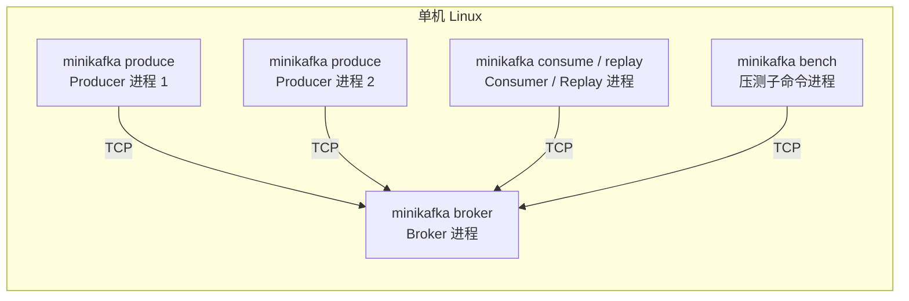
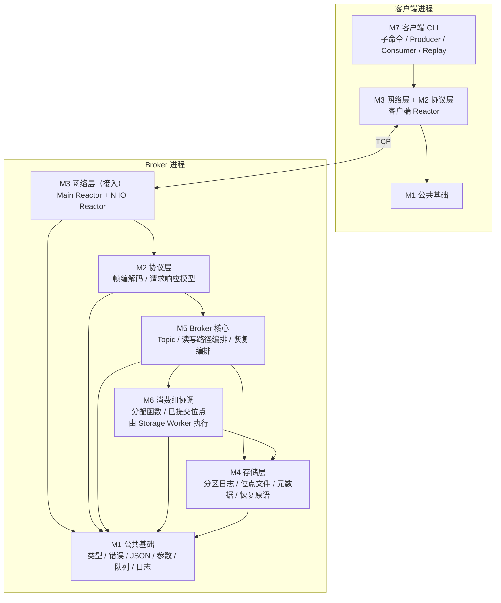
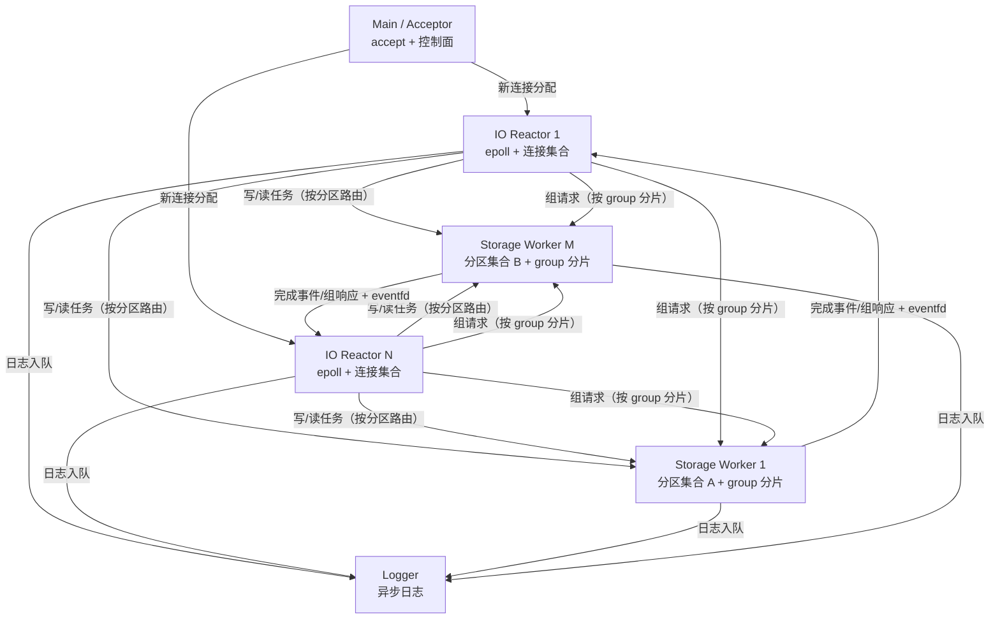
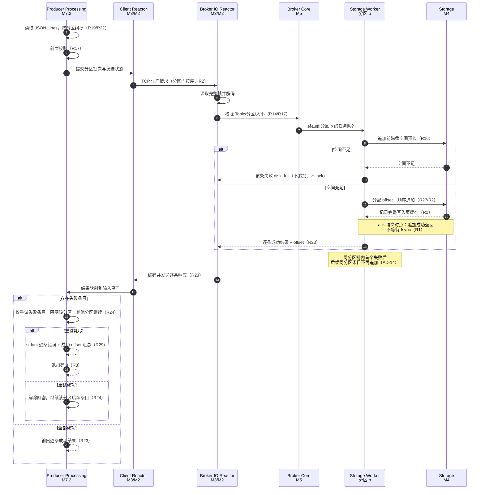
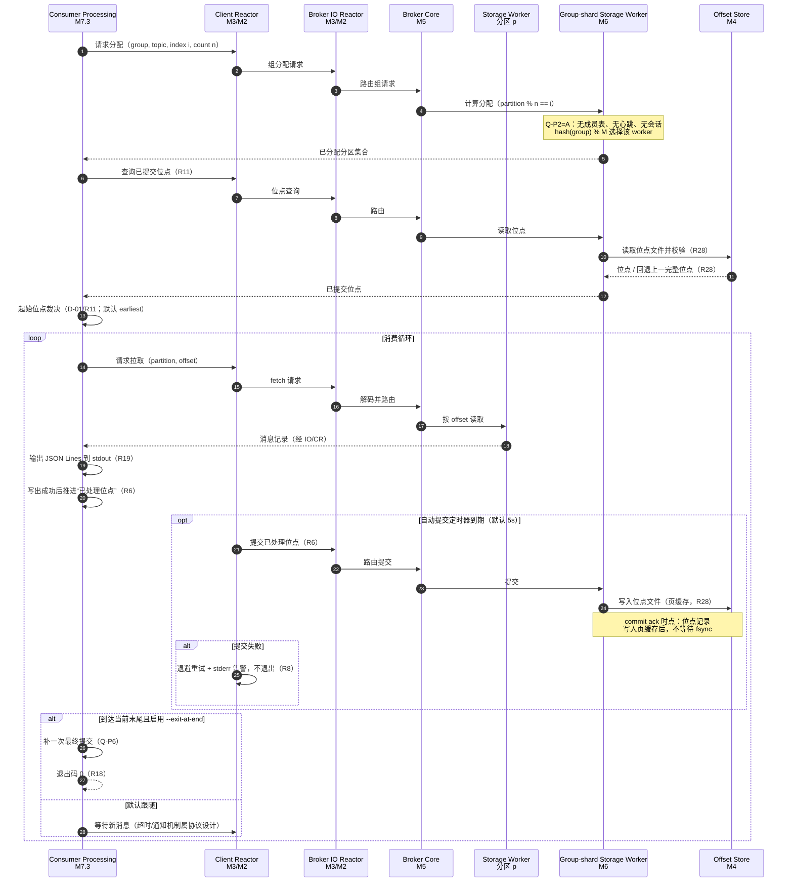
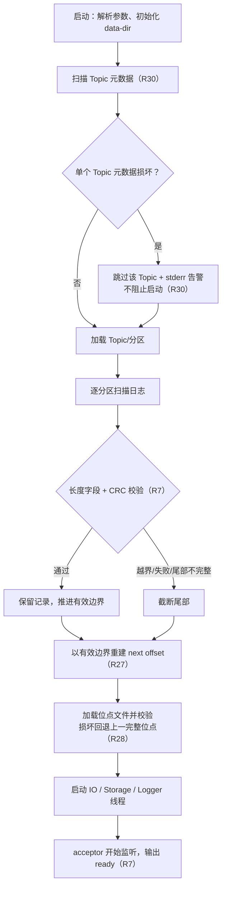
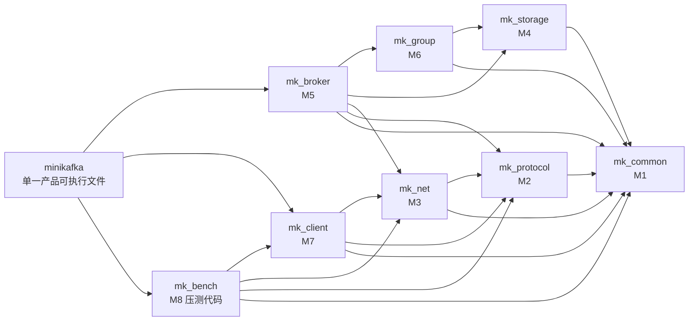

# 03. 整体架构设计

> 项目：miniKafka（类 Kafka 消息队列，演示验证型学习项目）
> 子阶段：设计阶段 第 2 子阶段（技术选型与整体架构设计）
> 状态：**已确认 v1.0**（v1.1 补充：broker 增加 `--segment-bytes`；v1.2 补充：broker/produce 增加 `--max-record-bytes`，见版本记录）
> 日期：2026-11-12
> **前置检查**：`docs/design/02.功能模块梳理.md` 头部为「**已确认 v1.0**」；`02-附录.流程与故障窗口.md` 为「**已确认 v1.0（随主文档）**」。符合 CLAUDE.md「# 2. 项目设计阶段规则」第 10 条，可以生成本文件。
> 输入：`docs/01.需求文档.md`（R1–R31，含第 6 节技术与平台约束、第 8 节 V1–V11）、`02.功能模块梳理.md` 及其第 9.2 节移交项、`prototype/CLI交互规范.md`。
> 边界：只确定技术选型、架构分层、模块映射、目录结构与关键决策；**不展开文件布局、消息二进制格式、索引设计、位点文件格式（属 04）；不定义帧格式与接口字段（属 05）；不写任何业务代码**。
> 说明：`docs/rules/` 当前为空；本阶段不涉及存储/协议格式，进入 04/05 前按 CLAUDE.md 生成对应规则草案并确认。

---

## 1. 文档说明

### 1.1 目的

1. 确认需求文档第 6 节已固定的技术约束，不重新选型。
2. 对 02 第 9.2 节移交的 Q-P1、Q-P3–Q-P14、A1、B1–B6 逐条给出结论与依据。
3. 对尚需决定的技术点给出候选、推荐与依据。
4. 给出分层架构、线程模型、模块映射与目录规划。
5. 用 Mermaid 画出生产写入路径与消费拉取路径，标明 ack 的准确环节。
6. 将 R16、R27、R28、R7、R23/R24、R30 落到具体线程与调用点，并映射 V1–V11。

### 1.2 明确不在本文件范围

| 内容 | 归属 |
| --- | --- |
| 分段文件命名、记录布局、CRC 算法、索引结构、位点文件格式 | 04 存储设计 |
| 帧格式、报文编号、字段布局、完整错误码表 | 05 协议设计 |
| 类/函数签名、具体实现、业务代码 | 实现阶段 |
| P1 动态 rebalance 的成员管理、心跳、会话、分配算法 | P1 |

### 1.3 状态标记

| 标记 | 含义 |
| --- | --- |
| **已固定** | 需求文档或 CLAUDE.md 已明确，不再讨论 |
| **建议** | 本文件推荐方案，等待审核确认 |
| **待确认** | 存在多方案或信息缺失，不作为既定事实 |
| **Q-*** | 02 移交或本文件新识别的待确认项 |
| **AD-*** | 本阶段架构决策（Architecture Decision） |
| **D-*** | 02 已确认的设计取舍，本文件沿用 |

### 1.4 已确认的输入结论

- 02 的 D-01–D-08 已确认；其中 D-03 按 **Q-P2=A** 改写。
- **Q-P2=A**：Consumer 启动时显式传 `--consumer-index i --consumer-count n`，按 `partition % n == i` 分配；**Broker 不维护组成员状态**；失效槽位分区暂停、不转移；重新加入必须使用相同 index。
- **Q-D1 已关闭，R30 生效**：Topic 元数据必须持久化；启动扫描重建；单个元数据损坏跳过并告警，不得阻止 Broker 启动。
- **Q-D2 已裁决**：M6 仅保留可替换的分配策略边界，不引入心跳/会话/成员状态接口。
- **D-06**：Replay 的“无组只读访问”已记入 05 协议设计输入。

---

## 2. 技术选型确认

### 2.1 已固定的技术约束

| 约束 | 内容 | 依据 | 架构影响 |
| --- | --- | --- | --- |
| 语言标准 | C++11/14 | 需求 §6 | 不使用 C++17 的 `std::filesystem`、`std::optional`、结构化绑定；由 AD-01 在 11/14 中确认 |
| 运行平台 | 仅 Linux | 需求 §6 | 直接使用 POSIX：epoll、eventfd、pthread、`statvfs`、`pread`/`pwrite`；不做跨平台抽象 |
| 构建系统 | CMake | 需求 §6 | 以 target 划分静态库与可执行文件，用 target 依赖强制分层 |
| 网络与协议 | 自研 TCP 网络与二进制协议 | 需求 §6、CLAUDE.md §4 | 禁止 boost.Asio、muduo、gRPC、protobuf、现成 MQ 库 |
| 协议约束 | 大端、长度前缀、CRC、单条 1MB 上限、批量逐条结果、完整错误码表 | CLAUDE.md §4、R17/R23 | 协议层负责帧编解码；具体帧格式在 05 定稿 |
| 部署形态 | 单机单 Broker，无副本/Raft | R25 | 无需集群协调、选主、副本同步 |
| 交付形态 | 单一产品可执行文件 + 子命令；压测工具 C++ 且与 Broker 同仓 | R15、R9、AD-10 | `minikafka` 为产品入口；压测代码在 `src/bench/`，链接进单一可执行文件 |
| 性能目标 | Broker 总入口 ≥10 万条/秒；send→ack P99 <10ms；100B payload + 8B key | R5、R4、R9、R26 | 热路径避免 fsync、全局锁与日志；支持批量与多连接 |
| 可靠性口径 | 页缓存即 ack；长度+CRC 恢复；offset 逻辑序号；位点文件校验；R30 元数据持久化 | R1/R7/R16/R27/R28/R30 | 决定线程分工、恢复时机与存储层职责 |

> 结论：技术栈不重新选择；以下只确定其内部实现形态。

### 2.2 尚需决定的技术点（AD）

> 下列均为**建议方案**，请审核确认后再作为实现前提。候选方案与推荐并列，未确认前不写成既定事实。

| 编号 | 技术点 | 候选 | 推荐 | 依据与权衡 | 状态 |
| --- | --- | --- | --- | --- | --- |
| AD-01 | 语言标准 | C++11 / C++14 | **C++14** | 需求允许 11/14；`std::make_unique`、`std::shared_timed_mutex`、`std::chrono` 便于实现；不使用 C++17 | 已确认 |
| AD-02 | epoll 触发模式 | LT / ET | **LT（水平触发）** | 10 万条/秒远低于事件循环能力；LT 不会因漏读 EAGAIN 造成连接停滞，调试简单；仍用非阻塞 socket + 读到/写到 EAGAIN。ET 作为压测后的可选优化 | 已确认 |
| AD-03 | Broker 网络模型 | 单 Reactor / 主从 Reactor / one loop per thread | **主从 Reactor** | Main Reactor 只做 accept/控制面；N 个 IO Reactor 各自绑定连接，互不阻塞；one loop per thread 是 main-sub 的特例 | 已确认 |
| AD-04 | 线程分工 | 单线程 / IO 与存储混合 / 分离 | **Main + N IO + M Storage + 1 Logger**（不设独立 Coordinator 线程） | 热路径、存储串行点、日志互不阻塞；M6 分配纯函数与位点文件读写并入 Storage Worker（按 group 分片），避免为低频组操作单独设线程 | 已确认 |
| AD-05 | 存储并发 | 单 commit 线程 / 分区亲和 worker 池 / 共享池 + 分区锁 | **分区亲和 worker 池** | 每分区只属于一个 worker，天然保序且无分区锁；跨分区并行；单 commit 线程虽可满足吞吐，但读写会互相阻塞 | 已确认 |
| AD-06 | 客户端网络模型 | 同步阻塞 / 单 Reactor + 处理线程 | **单 Reactor + 处理线程** | R24 重试退避与 R8 提交重试需要定时器；R6 自动提交需周期触发；stdin/stdout 不应阻塞网络循环 | 已确认 |
| AD-07 | JSON 编解码 | 自研受限 JSON / header-only JSON 库 | **自研受限 JSON** | 支持的是扁平对象 + 字符串值的受限子集，足够简单，避免引入编译负担与依赖管理；JSON 库不在需求 §6 禁令范围内，自研是项目选择而非需求强制；需严格转义与 UTF-8 校验 | 已确认 |
| AD-08 | 日志 | 同步 stderr / 异步 logger + 事件输出分离 | **异步 logger + 独立事件输出** | CLI 的 JSON Lines 事件不能与内部日志混流；热路径只入队；ERROR 同步兜底 | 已确认 |
| AD-09 | 测试方案 | 第三方框架 / 自研断言 + CTest | **自研轻量断言 + CTest + Sanitizers** | 零第三方依赖；单元/集成/故障/压测分层；ASan/TSan/UBSan 捕获内存与并发问题 | 已确认 |
| AD-10 | 压测工具形态 | `minikafka bench` 子命令 / 独立可执行 | **`minikafka bench` 子命令**：压测代码保留独立 `src/bench/`，编译为 `mk_bench` 并链接进单一 `minikafka` | R15 要求交付只需一个构建产物；压测代码独立目录避免与产品逻辑耦合；**不采用独立 `mkbench`**（会引入第二个构建产物） | 已确认 |
| AD-11 | 错误处理与资源管理 | 异常驱动 / 错误码 + RAII | **`Status`/`StatusOr` + RAII；异常仅用于启动期不可恢复错误** | 热路径不抛异常；fd/file/epoll/thread 全部 RAII；消息 move 跨队列传递 | 已确认 |
| AD-12 | 跨线程队列 | 无界 / 有界 + 背压 / 无锁环 | **有界 MPSC（互斥量 + 条件变量）+ eventfd + 高低水位** | 防止慢客户端/慢磁盘导致内存膨胀；10 万条/秒规模互斥队列足够；压测后再考虑无锁 | 已确认 |
| AD-13 | “Broker 接受顺序”定义 | 按连接到达顺序 / 按分区任务队列入队顺序 | **按分区任务队列入队顺序** | 跨连接写同一分区必须由一个串行点定序；该顺序即 R2 的写入/消费顺序 | 已确认 |
| AD-14 | 批内失败处理 | Broker 继续追加同分区后续 / 首个失败后停止 | **首个失败后停止该分区后续追加，其他分区继续** | 若批次已到达 Broker，继续追加会让后续条目越过失败条目，违反 R2/R24；停止后由客户端重试失败条目再继续 | 已确认 |
| AD-15 | Topic 元数据并发 | 全局读写锁 / 不可变快照 | **不可变快照（`shared_ptr` + 原子读写）** | Topic 创建是低频控制面操作；热路径无锁读取；创建时整体替换快照 | 已确认 |
| AD-16 | 恢复时机 | 与 acceptor 并行 / 恢复完成后才服务 | **恢复完成后才启动 acceptor** | R7 要求启动成功即服务；避免恢复期间请求看到半截数据 | 已确认 |
| AD-17 | P1 预留 | 不预留 / 最小扩展点 / 完整实现 | **仅 `AssignmentPolicy` 接口**；不引入心跳、会话、成员状态及额外定时器能力 | 02 已裁决 Q-D2 / D-07 为最小预留；P1 另行设计 | 已确认 |
| AD-18 | 优雅退出 | 不处理信号 / 处理 SIGINT/SIGTERM | **处理 SIGINT/SIGTERM：停止 accept、停止接收新任务、join 线程；`kill -9` 仍按崩溃恢复验证** | 运维与验收脚本需要可预期退出；不改变 R1/R7 的崩溃语义 | 已确认 |

### 2.3 语言、平台与构建

- **C++14**：使用 `std::make_unique`、`std::chrono`、`std::atomic`；不使用 `std::filesystem`（C++17）；文件/目录操作使用 POSIX 封装。
- **仅 Linux**：epoll、eventfd、signalfd/self-pipe、`statvfs`、`pread`/`pwrite` 直接使用。
- **CMake**：模块编译为静态库；可执行文件只负责链接与子命令分派；测试通过 CTest 注册；Debug 提供 ASan/TSan/UBSan 开关。
- **线程库**：`std::thread` + `std::mutex` + `std::condition_variable` + `std::atomic`；线程创建/join 由 RAII 封装，禁止 detach 后失去生命周期控制。
- **编译选项**：建议 `-Wall -Wextra`；是否 `-Werror` 待实现阶段按编译器版本确定。

### 2.4 内存与资源管理口径（RAII）

| 资源 | 管理方式 | 说明 |
| --- | --- | --- |
| 文件描述符 | `UniqueFd`（自定义 deleter） | socket、epoll、eventfd、文件统一封装；禁止裸 `close` 散落 |
| 文件句柄 | `UniqueFile` / `FileHandle` | 分区日志、位点文件、元数据文件；析构自动关闭 |
| 线程 | `ScopedThread` / `ThreadGroup` | 构造即启动；析构前必须 join；禁止游离线程 |
| 堆对象 | `std::unique_ptr` 为主；`std::shared_ptr` 仅用于共享生命周期（连接、不可变快照） | 业务代码禁止裸 `new/delete` |
| 缓冲区 | `std::vector<char>` / `std::string` + `reserve` + move | 连接读写缓冲复用；跨线程任务 move 转移，避免深拷贝 |
| 锁 | `std::lock_guard` / `std::unique_lock` | 禁止手工 lock/unlock；禁止持锁做 I/O |
| 队列元素 | 值语义或 `unique_ptr`，move 入队/出队 | 任务对象不可复制 |
| 错误 | `Status` / `StatusOr<T>` | 热路径返回错误码；异常仅用于启动期不可恢复错误 |
| 连接生命周期 | 所属 IO 线程唯一持有；跨线程任务携带 `shared_ptr<Connection>` 或连接代际 id | 连接关闭后迟到完成事件必须安全丢弃，禁止悬垂裸指针 |

**并发总口径**：高频路径采用“单一所有者 + 消息传递”；共享只读数据用不可变快照；共享计数器用原子；不用全局大锁保护热路径。

### 2.5 日志与可观测性方案

1. **两类输出分离**
   - **CLI 事件输出**：面向用户/脚本的 JSON Lines（`broker_started`、`ready`、`recovery`、`assigned`、`commit`、`retry`、错误对象、`produce_summary`），按 CLI 规范输出到 stdout/stderr。
   - **内部日志**：纯文本诊断日志，默认写 stderr，不进入 stdout，避免污染 JSON Lines。
2. **异步 logger**
   - 独立 logger 线程 + 有界 MPSC 队列；业务线程只入队。
   - 队列满时丢弃 DEBUG/INFO，保留 WARN/ERROR；ERROR 同步兜底。
   - 默认级别 WARN；`--log-level` 是否暴露属 CLI 契约（B4，建议提供）。
3. **热路径禁日志**
   - 每条消息的 produce/fetch 不打日志；只记录错误、恢复、状态变化。
   - 性能数据由 `minikafka bench` 外部统计，不依赖 Broker 日志。
4. **确定性**
   - 验收相关事件不含时间戳、随机值、绝对路径（CLI §1.3）；内部日志可含时间戳，但不得混入 stdout。

### 2.6 测试方案

| 层次 | 内容 | 方式 |
| --- | --- | --- |
| 单元测试 | JSON Lines、协议帧编解码、offset 计算、分区选择、恢复截断、位点校验/回退、批量结果聚合 | 自研轻量断言 + CTest，链接静态库 |
| 集成测试 | 启动 Broker + 多 Producer/Consumer CLI，验证 produce→ack、fetch→commit、replay、静态分配 | CTest 调用脚本或进程级测试驱动；临时 data-dir |
| 故障注入 | `kill -9` Broker/Consumer、磁盘满（tmpfs/配额）、损坏日志尾部、损坏位点文件、损坏 Topic 元数据、超大消息、批内部分失败 | `scripts/fault_injection/`；仿真钩子不得进入产品 CLI |
| 并发/内存 | 多 Producer、多 IO 线程、存储 worker 切换 | Debug 构建 ASan/TSan/UBSan，重复压力运行 |
| 性能验收 | V4 吞吐、V5 ack 延迟 | `minikafka bench`；固定基准机（A1）、固定参数、固定负载（R9/R26） |
| 黑盒验收 | V1、V2、V4–V11 | `scripts/acceptance/`，按验收矩阵执行 |

- 不引入第三方测试框架。
- 验收脚本以 Bash + coreutils 为主；复杂 JSON 断言可用项目自研 C++ 小工具，避免运行时依赖。
- 故障通过外部手段注入（kill、tmpfs、人工损坏文件），不把原型 `MK_DEMO_*` 钩子带入最终 CLI。

---

## 3. 移交项裁决（Q-P1、Q-P3–Q-P14、A1、B1–B6）

> Q-P2 已在 02 裁决为 A，本阶段只描述其架构落点（见 4.6），不重复裁决。
> 以下结论已由本次裁决确认。

### 3.1 Q-P 系列裁决

| 编号 | 结论 | 依据与说明 | 状态 |
| --- | --- | --- | --- |
| Q-P1 | `--from` 默认 **earliest** | 演示/验收首次消费应看到已有数据；`latest` 会让首次演示为空；R11 已规定已提交位点优先，因此默认只影响无位点场景 | 已确认 |
| Q-P3 | 重试默认 **3 次**（不含首次，最多 1+3 次）；退避 **100ms 起、指数×2、上限 1s**；单条目总超时 **5s**；提交重试单独使用 100ms–1s 退避且不设总超时（R8） | 与 R3 的“次数与总超时可配”一致；无抖动以保证验收可复现；5s 足以覆盖演示中的瞬时故障 | 已确认 |
| Q-P4 | 自动提交间隔默认 **5s** | 崩溃重复窗口 ≤5s；演示可预测；可配置；R6 只要求“定时持久化已处理位点” | 已确认 |
| Q-P5 | 与 B1 合并：**FNV-1a 32-bit**，对 key 的 UTF-8 字节计算，`hash % partitions` | 简单、无依赖、跨进程/版本稳定；`std::hash` 不保证稳定，禁止使用；需固定测试向量 | 已确认 |
| Q-P6 | 正常退出（Ctrl+C / `--exit-at-end`）**强制补一次位点提交**；提交最多等待 2s；失败则 stderr 告警后仍以 0 退出 | 减少重复窗口；失败只造成重复、不丢消息，符合 R6/R8；SIGKILL 不提交 | 已确认 |
| Q-P7 | `--from <n>` / `--offset <n>`：`0 ≤ n ≤ 当前分区末尾`；**等于末尾允许**（消费等待/回放无输出）；**大于末尾**返回 `offset_out_of_range`（退出 3）；负数/非整数按用法或校验错误处理；replay `--count` 超过可读条数时输出现有条数并成功退出 | 边界明确、脚本可断言；等于末尾是合法的“从末尾开始跟随”语义 | 已确认 |
| Q-P8 | Topic 名：`[a-z0-9_-]{1,64}`；仅小写字母/数字/`-`/`_`；拒绝 `/` 与 `..`；非法返回 `invalid_topic_name`（退出 3） | 与本次建议一致；比原型的 `[A-Za-z0-9_-]+` 更严格；避免路径穿越与大小写歧义 | 已确认 |
| Q-P9 | 退出码：0 成功（含消费者正常退出并完成最终提交）；2 用法错误；3 校验/业务错误；4 投递失败（重试耗尽）；130 保留给非消费者角色被 SIGINT 中断。错误统一 `{"error":"<code>","message":"<说明>"}`；完整错误码表在 05 定稿 | 与 CLI 规范 0/2/3/4 一致；4 仅用于投递失败，避免与校验错误混淆 | 已确认 |
| Q-P10 | `broker` **前台常驻**，不做 daemon；默认端口 **9092**；默认数据目录 **`./data`**；内部日志 stderr，CLI 事件 stdout | 前台便于验收脚本管理 PID；R20 要求参数化；`./data` 与源码目录分离，脚本仍显式传 `--data-dir` | 已确认 |
| Q-P11 | 磁盘安全阈值默认 **256 MiB**；参数 `--min-free-space-mb`；按批次在追加前预检；低水位状态缓存并周期复查；预检通过但写入失败仍不得 ack | 256 MiB 足以容纳 1MB 消息与写放大，适合演示 VM；R16 要求 ack 前主动检查 | 已确认 |
| Q-P12 | R29 汇总输出到 **stdout**，JSON Lines 事件 `produce_summary`；重试/生命周期事件在 stderr | 脚本可同时解析逐条结果与汇总；stderr 保持诊断用途；与原型格式一致 | 已确认 |
| Q-P13 | 批量指定 `--partition` 时，**整批全部写入该分区**；key 仍保存，但不参与分区选择 | 与原型一致；语义简单、可预测；无 `--partition` 时才按 key 哈希/轮询逐条选择 | 已确认 |
| Q-P14 | `value` 仅支持 **UTF-8 JSON 字符串**；`key` 可选 UTF-8 字符串；二进制/base64 **P1**；`value` 缺失或非字符串返回 `invalid_value_type`；未识别字段忽略 | 与本次建议一致；JSON 转义支持换行等控制字符；降低自研 JSON 解析器复杂度 | 已确认 |

**Q-P8 补充**：Topic 名不含 `.`，因此 `..` 本身已被正则拒绝；代码仍需显式做路径穿越检查，作为纵深防御。

**Q-P14 补充**：`key` 字段**存在**（包括空字符串）即参与哈希；**缺失或为 null** 视为无 key，进入轮询。这样满足 R14“同一 key 始终映射同一分区”。

**JSON 子集与校验范围（AD-07 / Q-P14）**

- 结构：只接受扁平 JSON 对象；`key` 可选字符串，`value` 必须字符串；不支持嵌套对象/数组/数字/布尔/null 作为 value。
- 转义：支持 `\"`、`\`、`\/`、`\b`、`\f`、`\n`、`\r`、`\t`、`\uXXXX`；`\uXXXX` 支持代理对，拒绝孤立代理项、非法十六进制与未转义控制字符。
- UTF-8：`key`/`value` 必须是合法 UTF-8；拒绝 overlong 编码、非法继续字节、UTF-8 编码的代理项；输出时对控制字符、引号、反斜杠做 JSON 转义。
- 说明：JSON 库不在需求文档第 6 节禁令范围内；自研是为了受限子集足够简单、避免引入编译负担（AD-07）。

### 3.2 B1–B6 裁决

| 编号 | 结论 | 说明 | 状态 |
| --- | --- | --- | --- |
| B1 | **FNV-1a 32-bit**，UTF-8 字节输入，`partition = hash % partition_count`；固定跨进程/跨版本；提供测试向量 | 与 Q-P5 合并；不使用实现相关的 `std::hash`；空 key 字符串也参与哈希 | 已确认 |
| B2 | **本阶段不下放格式细节**；04 存储设计确定记录长度字段、CRC 算法、分段格式；本阶段固定约束：顺序追加、分段文件、长度+CRC 恢复判据 | 遵守阶段边界；架构只要求 M4 提供扫描/截断/重建能力 | 已确认（04 细化） |
| B3 | **本阶段不下放格式细节**；04 确定位点文件校验方式与“上一份完整位点”保留策略；本阶段固定：带完整性校验、损坏回退、不得阻止启动 | 与 R28 一致；Group-shard Storage Worker 独占位点文件 | 已确认（04 细化） |
| B4 | 采用下文 **3.4 CLI 契约**中的命名与默认值 | 本阶段统一 CLI 契约；实现阶段不得擅自改名 | 已确认 |
| B5 | 分段大小、批量上限等**本阶段不固定数值**；04/05 决定；本阶段要求有界、可配置、不得无界增长 | 批量上限影响协议与内存；分段大小影响恢复与滚动 | 已确认（04/05 细化） |
| B6 | P1 才实现动态 rebalance；MVP 不引入心跳、会话、成员状态；仅保留 `AssignmentPolicy` 最小边界 | 与 Q-D2 一致；P1 参数另行设计 | 已确认（P1） |

### 3.3 A1 基准机配置（已确认）

> 已确认并回写 `docs/01.需求文档.md` R9（2026-11-12）。基准机为 VMware Ubuntu 虚拟机。

| 项目 | 配置 | 说明 |
| --- | --- | --- |
| CPU | **4 vCPU** | Broker + 多个 Producer + Consumer 同机运行；10 万条/秒为总入口目标，4 vCPU 足够 |
| 内存 | **8 GiB** | 页缓存 ack 依赖 OS 缓存；8 GiB 给页缓存、队列与多进程留余量 |
| 磁盘 | **SSD 虚拟磁盘** | 避免机械盘随机 I/O 与恢复扫描抖动；R9 要求固定基准机 |
| 宿主机 | **AMD Ryzen 7 7435HS（16 GB RAM）** | VMware Ubuntu 虚拟机 |
| 环境 | 单机 Linux 虚拟机；Broker 单实例；同一脚本/参数 | R9 |

### 3.4 CLI 契约（B4）

> 以下契约已随本次裁决确认；未列出的参数不得擅自增加。

| 命令 | 参数与默认值 | 说明 |
| --- | --- | --- |
| `minikafka broker` | `--port 9092`；`--data-dir ./data`；`--io-threads <n>` 默认 `min(4, max(1, cores/2))`；`--storage-threads <n>` 默认同上；`--min-free-space-mb 256`；`--segment-bytes 268435456`（下限 2097152）；`--max-record-bytes 1048576`（范围 1..1048576）；`--log-level warn` | 前台常驻；启动时先恢复再监听；`--segment-bytes` 与 storage-rules S-03/04 §4.3 对齐；`--max-record-bytes` 落实 R17 的“Broker 端可配置”，上限受 S-09/P-08 约束 |
| `minikafka topic create` | `--topic <name>` 必填；`--partitions <1..16>` 必填 | 名称规则见 Q-P8；重复返回 `topic_exists` |
| `minikafka topic list` | 无参数 | 每个 Topic 一行 JSON |
| `minikafka produce` | `--topic <name>` 必填；`--partition <n>` 可选；`--retries 3`；`--retry-backoff-ms 100`；`--retry-timeout-ms 5000`；`--max-record-bytes 1048576`（范围 1..1048576）；`--message '<json>'` / `--file <path>` / stdin 三选一 | 输入优先级 `--message` > `--file` > stdin；批量逐条结果；汇总到 stdout；`--max-record-bytes` 用于与 Broker 侧上限对齐 |
| `minikafka consume` | `--topic <name>` 必填；`--group <name>` 必填；`--consumer-index <i>` 必填；`--consumer-count <n>` 必填；`--from earliest`；`--auto-commit-interval 5s`；`--exit-at-end` 关闭 | Q-P2=A；`0 ≤ i < n`；正常退出补一次提交 |
| `minikafka replay` | `--topic <name>` 必填；`--partition 0`；`--offset 0`；`--count <n>` 可选（默认读到末尾） | 只读；不提交、不改变 group 状态 |
| `minikafka bench` | `--broker <host:port>` 默认 `127.0.0.1:9092`；`--topic <name>` 必填；`--mode throughput\|latency` 默认 `throughput`；`--producers 4`；`--messages <n>`；`--batch <n>`；`--payload-bytes 100`；`--key-bytes 8` | 压测子命令；代码在 `src/bench/`，链接进单一 `minikafka`（AD-10/R9/R26） |
| `minikafka --help` / `<子命令> --help` | 无 | 提供用法说明 |

**CLI 通用约定**

- 流：stdout 输出结果/消息/逐条结果/`produce_summary`；stderr 输出生命周期事件、重试事件、错误对象、内部日志。
- 错误对象：`{"error":"<code>","message":"<说明>"}`。
- 退出码：0 成功；2 用法；3 校验/业务；4 投递失败；130 保留给非消费者 SIGINT 中断。
- `--consumer-index` 与 `--consumer-count` **必填**：Broker 不维护成员状态，无法检测重复 index；显式参数强制部署者保证槽位唯一（见 11.1）。
- 所有默认值固定并写入文档；验收脚本显式传参（R20）。

### 3.5 移交裁决的影响

- Q-P1/Q-P4/Q-P6/Q-P7/Q-P13/Q-P14 直接影响 Consumer/Producer 状态机与 CLI 契约。
- Q-P3/Q-P11 影响重试与磁盘状态机；Q-P9/Q-P12 影响协议错误模型与输出格式（05 细化）。
- B2/B3/B5 的格式细节必须在 04/05 前确认，否则存储/协议设计无输入。
- A1 已确认并回写 R9；性能验收使用该固定配置。

---

## 4. 整体架构设计

### 4.1 进程与部署视图

单二进制 `minikafka` 通过子命令区分角色（R15），但运行时是不同进程：



- 客户端与 Broker 只通过 TCP 交互，不共享进程内状态。
- 共享的是 `mk_protocol`、`mk_net`、`mk_common` 等代码库。
- 单二进制不意味着单进程；`broker` 与 `produce/consume/replay` 分别启动。

### 4.2 系统分层与职责



| 层次 | 组成 | 职责 | 明确不负责 |
| --- | --- | --- | --- |
| 公共基础层 | M1 | 类型、错误模型、JSON Lines、参数解析、时钟/退避、哈希、队列、日志、RAII | 业务规则、存储、网络、协议语义 |
| 协议层 | M2 | 逻辑请求/响应模型、帧编解码、CRC、长度前缀、错误映射 | socket、业务校验、存储、重试 |
| 网络层 | M3 | accept、连接管理、收发缓冲、事件循环、跨线程唤醒、客户端连接 | 业务语义、持久化、重试策略 |
| 存储层 | M4 | 分区日志读写、恢复扫描/截断、offset 重建、磁盘空间查询、位点/元数据文件原语 | Topic/组业务规则、客户端重试、协议 |
| Broker 核心 | M5 | Topic 元数据、写/读路径编排、恢复编排、请求路由、磁盘满策略 | 帧编解码、socket、客户端分区选择/重试 |
| 消费组协调 | M6 | 无状态分配函数、已提交位点、P1 扩展边界 | 成员状态、心跳、会话、消息读写 |
| 客户端 CLI | M7 | 子命令、输入输出、Producer/Consumer/Replay 状态机 | 直接访问存储、复制服务端规则 |
| 压测工具 | M8 | 吞吐/延迟测量，复用客户端发送链路 | 产品功能、Broker 行为变更 |

### 4.3 线程模型

> 线程数为建议默认值，可通过 `--io-threads`、`--storage-threads` 覆盖；最终默认值见 3.4 CLI 契约。

| 线程 | 数量 | 所属层 | 职责 | 持有状态 |
| --- | --- | --- | --- | --- |
| Main / Acceptor | 1 | M3 + M5 | 解析参数、执行恢复、启动线程、运行主 Reactor accept、控制面请求 | 配置、Topic 快照入口、启动状态 |
| IO Reactor | N；默认 `min(4, max(1, cores/2))` | M3 + M2 | 每线程一个 epoll；连接读写、帧编解码、请求分发、响应编码 | 所绑定连接、读写缓冲、完成队列 |
| Storage Worker | M；默认 `min(4, max(1, cores/2))` | M4 + M5 + M6 | 每个 worker 拥有一组分区；按 `hash(group) % M` 承担 M6 的分配纯函数与位点文件读写；磁盘预检、offset 分配、追加、读取 | 所拥有分区的文件句柄、`next_offset`、所属 group 的已提交位点、读缓冲 |
| Logger | 1 | M1 | 异步消费日志队列，写 stderr | 日志队列、输出缓冲 |
| Client Reactor | 1 / 客户端进程 | M3 + M2 | 客户端网络收发、重试定时器、自动提交定时器、跟随等待 | 连接、请求队列、定时器 |
| Client Processing | 1 / 客户端进程 | M7 | 读 stdin/写 stdout、构建批次、打印结果/汇总、维护已处理位点 | 输入输出缓冲、本地状态 |
| Bench Worker | K / `minikafka bench` 进程 | M8 | 每个 worker 一条连接，生成负载、统计延迟/吞吐 | 本地统计（原子计数器） |

> M6 不拥有线程：静态分配纯函数与位点文件读写由 Storage Worker 按 group 分片执行；**不设独立 Coordinator 线程**（AD-04/AD-17）。



**关键说明**

1. Main 线程先恢复再服务（AD-16）；恢复期间不接收客户端请求。
2. 每分区只属于一个 Storage Worker：分区内追加/读取在该 worker 内串行，无需分区锁；跨分区并行。
3. IO 线程不做磁盘 I/O，只做协议与连接管理，避免慢盘阻塞事件循环。
4. M6 不设独立线程：分配纯函数与位点文件读写由 Group-shard Storage Worker 执行；同一 group 的位点状态/文件只由 `hash(group) % M` 对应的 worker 访问。
5. Logger 单线程；业务线程只入队。
6. 完成事件按发起请求的 IO 线程回送（图中为简化只画了对应关系）。

### 4.4 线程间通信与背压

| 路径 | 机制 | 说明 |
| --- | --- | --- |
| IO → Storage Worker | 有界 MPSC 队列 + 条件变量 | 任务含解码请求、连接引用/代际 id、请求序号 |
| Storage Worker → IO | 完成队列 + eventfd | IO 线程在 epoll 中监听 eventfd，批量取完成事件 |
| IO → Storage Worker（group 分片） | 有界 MPSC 队列 + 条件变量 | 位点查询/提交、分配纯函数计算 |
| Storage Worker（group 分片） → IO | 完成队列 + eventfd | 组响应回到发起请求的 IO 线程 |
| 任意线程 → Logger | 有界 MPSC 队列 + 条件变量 | 队列满时降级/丢弃策略见 2.5 |
| 客户端 Processing ↔ Client Reactor | 有界队列 + eventfd/条件变量 | 批次输入、消息输出、提交触发 |
| 客户端 Reactor 内部 | 定时器队列 | 重试退避、自动提交、跟随超时 |

**背压规则**

- 每连接设置“在途请求上限”；超过上限时 IO 线程停止读取该连接（移除 `EPOLLIN`），降到低水位后恢复。
- Storage Worker 队列设高/低水位；高水位时暂停相关连接读取，避免无界内存增长。
- Producer 每分区发送队列有界；阻塞分区不再向 Broker 发送，其他分区继续。
- 禁止无界队列；禁止在热路径阻塞等待磁盘或锁。

> Group 分片规则：`hash(group) % M` 选择 Storage Worker；同一 group 的位点状态与位点文件只由该 worker 访问。

### 4.5 数据所有权与并发规则

| 数据/资源 | 唯一所有者 | 其他线程访问方式 | 同步 |
| --- | --- | --- | --- |
| 配置 | Main 初始化后只读 | 所有线程只读 | 启动后不可变 |
| Topic 元数据 | M5 控制面 | 所有线程读不可变快照 | 原子 `shared_ptr` 读写；创建时 copy-on-write（AD-15） |
| 分区日志句柄、`next_offset` | 所属 Storage Worker | 无 | 单线程独占，无锁 |
| 分区任务队列 | 所属 Storage Worker | IO 入队 | 有界队列 + 互斥量/条件变量 |
| 连接对象、读写缓冲 | 所属 IO 线程 | 完成事件用 `shared_ptr` 或代际 id 引用 | 单线程独占；关闭后任务安全丢弃 |
| 已提交位点 | Group-shard Storage Worker | 无 | 单 worker 独占，无锁 |
| 位点文件 | Group-shard Storage Worker（经 M4 原语） | 无 | 单 worker 独占 |
| Topic 元数据文件 | Main 启动加载/创建时写；运行时 M5 控制面 | M4 原语 | 控制面串行；不可变快照 |
| 磁盘空间状态 | Storage Worker 更新，全局可见 | 读取 | 原子状态或受保护共享状态；阈值策略在 M5（Q-P11） |
| 指标计数器 | 所有线程 | 原子读写 | `std::atomic` |
| 日志队列 | Logger | 所有线程入队 | 有界 MPSC 队列 |

**原则**：高频路径使用“单一所有者 + 消息传递”；共享只读数据用不可变快照；共享计数器用原子；不用全局大锁保护热路径。

### 4.6 Q-P2=A 的架构落点：Broker 零组成员状态

- **M6 不维护成员表**：没有成员注册、心跳、会话、分配结果持久化。
- **分配是纯函数**：`assign(partition_count, consumer_index, consumer_count) = {p | p % consumer_count == consumer_index}`；由接收请求的 Group-shard Storage Worker 计算并返回。
- **Group 分片**：`shard(group) = hash(group) % M`；该 group 的已提交位点与位点文件只由对应 Storage Worker 访问，分配纯函数可在任意 worker 计算，但状态归属固定。
- **M6 持久状态只有已提交位点**：键为 `(group, topic, partition)`，值为已提交 offset。
- **Broker 无法检测重复 index（RK-01 已裁决：不要求检测）**：若同一 group 两个消费者使用相同 index，它们会得到相同分区集合；这是部署/操作者错误，Broker 不纠正、不告警（无成员状态，无法知道另一个进程存在）。接受为部署约束：CLI 强制显式 index/count、验收脚本保证唯一、文档声明；P1 再引入成员管理。
- **验收要求**：V9 等多消费者脚本必须显式使用互不重复的 `consumer-index` 和一致的 `consumer-count`。
- **P1**：若改为 Broker 侧注册（02 的 B 方向），需要新增成员表、心跳、会话与 rebalance；不在 MVP 预埋。

---

## 5. 关键链路

### 5.1 生产写入路径（produce → ack）

**参与者**：Producer Processing（M7.2）、Client Reactor（M3/M2）、Broker IO Reactor（M3/M2）、Broker Core（M5）、Storage Worker（M4/M5）、存储层（M4）。

**步骤**

1. Producer 读取 JSON Lines（R19），按分区组批；客户端前置校验必填字段与单条上限（R17）。
2. 分区选择：显式 `--partition`（整批写该分区，Q-P13）> key 哈希 > 无 key 轮询（R22/B1）。
3. 每分区独立发送状态；同一分区同一时刻只允许一条消息/一批在途；失败后暂停该分区，其他分区继续（R2/R24）。
4. Client Reactor 发送请求；Broker IO 线程读取完整帧并解码（帧格式属 05）。
5. Broker Core 校验 Topic/分区/大小（R14/R17），按 `(topic, partition)` 路由到对应 Storage Worker。
6. Storage Worker 在追加前做**磁盘空间主动预检**（R16）；空间不足则该条失败，不追加、不 ack。
7. 空间充足时，Storage Worker 分配下一逻辑 offset（R27），按序追加到分区日志，依赖页缓存（R1）。
8. **ack 语义时点**：记录完整写入页缓存、追加调用成功返回后，该条才标记成功；**不等待 fsync**（R1）。写入失败则该条失败、不 ack；残缺尾部由恢复按 R7 截断。
9. 同分区批内首个失败后，后续同分区条目不追加；其他分区继续（AD-14，保证 R2/R24）。
10. Storage Worker 将逐条结果（成功 offset / 失败原因）作为完成事件发回 IO 线程。
11. IO 线程编码响应并发送；Client Reactor 映射回输入序号。
12. 客户端仅重试失败条目；分区阻塞，成功后继续；其他分区不受影响（R23/R24）。
13. 重试耗尽：stdout 输出逐条错误与按分区成功 offset 汇总（R29），以退出码 4 结束（R3）；仅校验类失败退出码 3。



**关键点**

- ack 的准确环节是 **Storage Worker 的追加成功返回**，不是客户端收到响应，也不是 fsync 完成。
- 磁盘预检与写入失败是两条防线：预检失败直接拒写；预检通过但写入失败仍不得 ack（R16）。
- 分区内顺序由 Storage Worker 任务队列串行执行保证；接受顺序定义见 AD-13。
- 批量是逐条结果，允许部分成功；客户端负责失败重试与分区阻塞。

### 5.2 消费拉取路径（fetch → 位点提交）

**参与者**：Consumer Processing（M7.3）、Client Reactor（M3/M2）、Broker IO Reactor（M3/M2）、Broker Core（M5）、Storage Worker（分区日志）、Group-shard Storage Worker（M6）、位点存储（M4）。

**步骤**

1. Consumer 启动后请求分配（R13）：`--consumer-index i --consumer-count n` 随请求提供（Q-P2=A）。
2. Broker Core 按 `hash(group) % M` 选择 Group-shard Storage Worker；该 worker 按 `partition % n == i` 计算分配并返回；**不记录成员、不持久化分配**。
3. Consumer 查询各分区已提交位点（R11）；Group-shard Storage Worker 读取位点文件，损坏回退上一完整位点（R28）。
4. Consumer 在客户端裁决起始位点（D-01）：有已提交位点则从其继续；否则按 `--from`（默认 earliest，Q-P1）。
5. Client Reactor 发送 fetch；IO 线程解码后路由到分区所属 Storage Worker；按 offset 顺序读取并返回。
6. Client Reactor 把消息交给 Processing；Processing 逐条输出 JSON Lines 到 stdout（R19）。
7. **仅成功写出后**，Processing 更新内存“已处理位点”（R6）。
8. Client Reactor 的自动提交定时器（默认 5s，Q-P4）读取已处理位点并提交。
9. Group-shard Storage Worker 更新内存位点，并经 M4 写入位点文件；**commit ack 时点 = 位点记录完整写入页缓存后**，不等待 fsync（R28/R1）。
10. 提交失败：Client Reactor 退避重试并向 stderr 告警；拉取仍可用则继续消费；断连持续重连；进程不主动退出（R8）。
11. 到达当前末尾：默认跟随；`--exit-at-end` 时先补一次最终提交（Q-P6），再以 0 退出（R18）。
12. 消费者崩溃重启：从最后已提交位点继续；最多重复“已处理但未提交”的区间（R6/R11/R28）。



**关键点**

- “已处理”的判定在客户端：成功写出 stdout 后推进（R6）。
- 位点提交失败不退出、不丢消息；最多重复未提交区间（R8/R28）。
- 已提交位点优先于 `--from`；起始位点裁决在客户端（D-01/R11）。
- 同一 group 的位点状态与位点文件只由对应 Group-shard Storage Worker 访问；无独立协调线程。
- Replay 复用读取路径，但不经过组分配路径、不提交位点、不改变组状态（R12/D-06）。

### 5.3 恢复路径（R7/R27/R28/R30）



- 恢复在 acceptor 启动前完成（AD-16）；恢复期间不对外服务。
- 校验通过的记录一律保留，与是否 ack 无关（R7）；已 ack 记录必然完整写入页缓存，因此可恢复（R1）。
- R30 元数据损坏只影响单个 Topic；其他 Topic 正常服务。
- 恢复失败（数据目录不可读、无任何可用元数据等）应明确报错，不进入服务状态；错误码在 05 统一。

### 5.4 热点路径原则

1. **无 fsync**：ack 与 commit 都只依赖页缓存（R1/R28）。
2. **无全局锁**：每分区单一 Storage Worker；Topic 元数据不可变快照。
3. **批量**：客户端按分区组批；Storage Worker 合并追加与完成事件；批量上限由 04/05 定。
4. **跨线程有界**：所有队列有界，高水位暂停读取；防止慢客户端拖垮内存。
5. **热路径不写日志**：只记录错误与状态变化。
6. **move 语义**：请求/响应对象跨队列移动，避免复制消息体。

---

## 6. 模块架构映射

### 6.1 M1–M7（及 M8）映射

| 模块 | 架构层 | 执行线程 | 主要职责 | 调用/依赖 |
| --- | --- | --- | --- | --- |
| M1 公共基础 | 基础层 | 所有线程 | 类型、错误、JSON、参数、时钟、哈希、队列、日志、RAII | 被所有模块调用 |
| M2 协议层 | 接入层 | Broker IO Reactor；客户端 Reactor | 逻辑请求/响应模型、帧编解码、CRC/长度前缀、错误映射 | 被 M3、M5、M7、M8 调用 |
| M3 网络层 | 接入层 | Main Reactor、IO Reactor；客户端 Reactor | accept、连接管理、收发缓冲、事件循环、eventfd 唤醒 | 调用 M2；被 M5、M7、M8 调用 |
| M4 存储层 | 存储层 | Storage Worker（日志 + group 分片位点文件）；Main（元数据/恢复） | 分区日志读写、恢复扫描/截断、offset 重建、磁盘空间、位点/元数据文件原语 | 被 M5、M6 调用；不持线程 |
| M5 Broker 核心 | 业务编排层 | Main（启动/恢复）、IO（校验/路由）、Storage Worker（执行） | Topic 元数据、写/读路径编排、恢复编排、请求路由、磁盘满策略 | 调用 M3/M2/M4/M6 |
| M6 消费组协调 | 业务编排层 | Storage Worker（group 分片） | 无状态分配、已提交位点、P1 扩展边界；**无成员状态、无独立线程** | 调用 M4；被 M5 调用 |
| M7 客户端 CLI | 客户端层 | Client Reactor + Processing | 子命令、Producer/Consumer/Replay 状态机、输入输出 | 调用 M3/M2 |
| M8 压测工具 | 辅助层 | Bench Worker | 吞吐/延迟测量 | 复用 M7.2、M3/M2 |

> M4、M5、M6 是逻辑层，不各自拥有独立“业务线程”：M5 的编排函数在资源所有者线程中执行（Main/IO/Storage Worker），M4 原语由调用线程执行，M6 的组请求由 Storage Worker 按 group 分片执行。避免为分层制造无谓线程与队列。

### 6.2 运行时调用关系

| 场景 | 调用链 | 跨线程点 |
| --- | --- | --- |
| Topic 创建/列表 | 客户端 → IO Reactor → M5 控制面 → Topic 快照更新 → M4 元数据持久化（R30） | IO → Main/控制面任务 |
| 生产消息 | 客户端 Processing → Client Reactor → Broker IO Reactor → M5 校验/路由 → Storage Worker → M4 日志 | IO → Storage 队列；Storage → IO 完成事件 |
| 消费拉取 | 客户端 Reactor → Broker IO Reactor → M5 路由 → Storage Worker → M4 读取 | IO → Storage 队列；Storage → IO 完成事件 |
| 组分配/位点 | 客户端 Reactor → Broker IO Reactor → M5 路由 → Storage Worker（group 分片） → M4 位点文件 | IO → Storage 队列；Storage → IO 完成事件 |
| 只读回放 | 客户端 Reactor → Broker IO Reactor → M5 路由 → Storage Worker → M4 读取 | 同消费拉取；不经过组分配路径 |
| Broker 恢复 | Main → M5 → M4（元数据/日志扫描）；M5 → Storage Worker（group 分片） → M4（位点恢复） | 恢复阶段无并发客户端 |
| 压测 | Bench Worker → 客户端发送链路 → Broker | 同生产消息 |

### 6.3 依赖规则

1. 编译期依赖单向：M7/M5 → M3 → M2 → M1；M5 → M4；M6 → M4。
2. 运行时跨线程只通过有界队列/eventfd 传递，不共享可变业务对象。
3. M6 组逻辑只访问位点/分配，不读取消息日志；分区日志操作不依赖 M6 状态。
4. 客户端不直接访问 M4；所有服务端能力经 M3/M2 逻辑请求。
5. M3 通过 M5 注册的请求处理器分发，避免 M3 → M5 反向编译依赖。

---

## 7. 项目目录设计

### 7.1 源码目录

```text
Kafka消息队列/
├── CMakeLists.txt                 # 顶层构建入口
├── include/
│   └── minikafka/
│       ├── common/                # M1 对外头文件
│       ├── protocol/              # M2 对外头文件
│       ├── net/                   # M3 对外头文件
│       ├── storage/               # M4 对外头文件
│       ├── broker/                # M5 对外头文件
│       ├── group/                 # M6 对外头文件
│       └── client/                # M7 对外头文件
├── src/
│   ├── common/                    # M1 实现 + 私有头
│   ├── protocol/                  # M2 实现 + 私有头
│   ├── net/                       # M3 实现 + 私有头
│   ├── storage/                   # M4 实现 + 私有头（含 R30 元数据持久化、位点文件原语）
│   ├── broker/                    # M5 实现 + 私有头（Topic 注册表、恢复编排）
│   ├── group/                     # M6 实现 + 私有头
│   ├── client/                    # M7 实现 + 私有头
│   ├── bench/                     # M8 压测代码（mk_bench，链接进 minikafka）
│   └── main.cpp                   # 子命令分派入口
├── test/
│   ├── unit/                      # 模块级单元测试
│   ├── integration/               # 进程级黑盒/集成测试
│   └── fixtures/                  # JSONL、损坏日志/位点/元数据文件
├── scripts/
│   ├── acceptance/                # V1、V2、V4–V11 验收脚本
│   ├── fault_injection/           # kill -9、磁盘满、文件损坏
│   └── bench/                     # 压测驱动与结果汇总
├── docs/
│   ├── 01.需求文档.md
│   ├── 需求澄清记录.md
│   ├── design/                    # 02、03 及后续设计文档
│   └── rules/                     # 存储/协议规则（阶段 4/5 前补充）
├── prototype/                     # 交互原型，保留但不参与构建
└── build/                         # CMake 生成目录，gitignore
```

- `include/minikafka/<module>/`：模块对外 API 边界；测试与上层只依赖这里。
- `src/<module>/`：实现与私有头；禁止跨模块包含私有头。
- `src/main.cpp`：只做子命令分派，不承载业务逻辑。
- `src/bench/`：压测代码独立目录，编译为 `mk_bench` 静态库并链接进 `minikafka`；不产生独立可执行文件。
- `docs/rules/`：当前为空；进入 04/05 前生成 `storage-rules.md`、`protocol-rules.md` 草案并确认。

### 7.2 运行时数据目录（R30 元数据位置）

> 仅确定目录层级；具体文件名、文件布局、索引与格式在 04 存储设计确定。

```text
<data-dir>/                       # 默认 ./data
├── meta/                         # R30 Topic 元数据
├── topics/                       # 分区日志（目录层级在 04 细化）
└── groups/                       # 已提交位点文件（R28）
```

- **R30 Topic 元数据文件放在 `<data-dir>/meta/`**，由 M4 提供持久化原语，M5 负责名称/分区数语义与启动扫描重建。
- 单个元数据损坏：跳过该 Topic + stderr 告警，其他 Topic 正常；不阻止 Broker 启动（R30）。
- 源码落点：`src/storage/`（持久化原语）+ `src/broker/`（Topic 注册表与恢复编排）。
- `topics/` 与 `groups/` 的具体分段、文件命名、校验方式在 04 定；本文件不展开。

### 7.3 单二进制 + 子命令（R15）与 CMake target

- **唯一产品入口**：`minikafka`。
- **分派**：`src/main.cpp` 解析子命令 → `mk_broker` / `mk_client` / `mk_bench`。
- **内部仍分层**：各模块编译为静态库；`main.cpp` 只链接与分派。
- **压测同二进制**：压测代码保留在 `src/bench/`，编译为 `mk_bench` 静态库并链接进 `minikafka`；`minikafka bench` 是产品可执行文件的子命令，**不产生第二个构建产物**（AD-10/R15）。



**规则**：CMake `target_link_libraries` 只允许向下依赖；上层包含下层私有头视为架构违规。

## 8. 关键决策的线程与调用落点

### 8.1 R16 / R1：磁盘预检与页缓存 ack

| 环节 | 落点 |
| --- | --- |
| ack 时点 | Storage Worker 调用 M4 追加；记录完整写入页缓存、追加成功返回后，该条才成功；不 fsync（R1） |
| 主动预检 | Storage Worker 在追加前按批次检查可用空间（默认阈值 256 MiB，Q-P11）；不足则拒绝该批/该条，不追加、不 ack |
| 写失败兜底 | 预检通过但写入失败仍返回错误、不 ack；恢复按 R7 截断残缺尾部 |
| 磁盘低状态 | Storage Worker 维护/共享低空间状态；周期复查；恢复后允许写入 |
| 读路径 | 磁盘满只影响写；Storage Worker 读取继续，Broker 进程存活（R16） |

### 8.2 R27 / R2：offset 逻辑序号与分区内保序

| 环节 | 落点 |
| --- | --- |
| 顺序串行点 | 每分区只属于一个 Storage Worker；该分区任务队列串行执行（AD-13） |
| offset 分配 | Storage Worker 持有 `next_offset`；按追加顺序分配逻辑序号（R27） |
| 批量顺序 | 同批同分区按输入顺序处理；首个失败后同分区后续不追加（AD-14） |
| 重启重建 | Main 恢复阶段由 M4 扫描有效边界，重建 `next_offset`（R27）；已写 offset 不变，截断尾部不占 offset |
| 客户端 | Producer 按分区维护发送状态；失败条目未成功前不越过该分区后续消息（R2/R24） |

### 8.3 R28：位点文件完整性校验与回退

| 环节 | 落点 |
| --- | --- |
| 所有者 | Group-shard Storage Worker 独占位点状态与位点文件访问 |
| 提交 | 客户端定时提交；Group-shard Storage Worker 更新内存并调用 M4 写位点文件 |
| ack 时点 | 位点记录完整写入页缓存后返回成功；不额外 fsync（R28/R1） |
| 完整性 | M4 提供带校验的读写原语；校验方式与“上一份完整位点”保留策略在 04（B3） |
| 损坏回退 | 最新位点损坏回退上一完整位点；不得阻止 Broker 启动或丢失全部位点 |
| 影响 | 回退可能造成重复消费；仍满足至少一次（R3/R6） |

### 8.4 R7：崩溃尾部截断

| 环节 | 落点 |
| --- | --- |
| 时机 | Main 线程在 acceptor 启动前完成（AD-16） |
| 判据 | M4 按记录长度字段 + CRC 校验；校验通过一律保留，与 ack 无关 |
| 截断 | 长度越界、CRC 失败、尾部不完整 → 丢弃并截断 |
| 重建 | 以最后有效记录边界重建下一 offset（R27） |
| 结果 | 无需人工干预；完成后 ready（R7） |

### 8.5 R23 / R24：批量逐条结果与分区级阻塞重试

| 环节 | 落点 |
| --- | --- |
| Broker 端 | Storage Worker 逐条处理并返回结果；成功含 offset，失败含原因/标识 |
| 批内失败 | 同分区首个失败后，后续同分区条目不追加；其他分区继续（AD-14） |
| 协议层 | 响应模型支持逐条结果；具体报文编码在 05 |
| 客户端 | Producer Processing 维护每分区状态；失败条目重试，分区阻塞，其他分区继续（R24） |
| 退出 | 重试耗尽输出逐条错误 + 按分区成功 offset 汇总（R29），非 0 退出（R3） |

### 8.6 R30：Topic 元数据启动扫描重建

| 环节 | 落点 |
| --- | --- |
| 写入 | Topic 创建时 M5 控制面更新元数据快照，M4 将名称/分区数持久化到 `<data-dir>/meta/` |
| 启动 | Main 线程在 acceptor 前扫描元数据目录，重建内存注册表 |
| 损坏 | 单个 Topic 元数据损坏：跳过该 Topic + stderr 告警，其他 Topic 正常（R30） |
| 并发 | 运行时 Topic 快照不可变；创建时 copy-on-write（AD-15） |
| 服务 | 存在损坏 Topic 不阻止 Broker ready；该 Topic 暂不可用，修复后可恢复 |

### 8.7 其他口径

| 口径 | 落点 |
| --- | --- |
| R3 | Producer 有限重试与明确失败（Q-P3）；耗尽退出码 4 |
| R4/R5 | 无 fsync、分区亲和、多 IO、批量、有界队列；`minikafka bench` 验证 |
| R6 | Consumer Processing 成功写出 stdout 后推进位点；Client Reactor 定时提交 |
| R8 | 提交失败退避重试与 stderr 告警，不主动退出 |
| R9/R26 | `minikafka bench` C++，固定负载 100B payload + 8B key，固定脚本/参数 |
| R10/Q-P2 | 客户端显式槽位；Broker 零成员状态；无 rebalance |
| R11 | 起始位点裁决在 Consumer；已提交位点优先 |
| R12 | Replay 走读路径，不经过组分配路径，不提交位点 |
| R13 | 组状态以 `(group, topic)` 为范围；MVP 单 Topic |
| R14 | Topic 创建/列表由 M5 控制面；分区数固定 |
| R15 | `minikafka` 单入口 + 内部静态库分层 |
| R17 | M5 权威校验单条上限；M7.2 前置校验 |
| R18 | 默认跟随；`--exit-at-end` 读到末尾退出 |
| R19/R20 | JSON Lines；命令行参数 + 固定默认值；无配置文件 |
| R21 | 不提供 Topic 删除、组/位点查询 |
| R25 | 单 Broker；无副本/Raft/保留期清理/ACL/Web |
| R29 | Producer 退出前 stdout 输出成功 offset 汇总 |

---

## 9. V1–V11 验收项与模块映射

| 验收 | 主要承担模块 | 关键落点 |
| --- | --- | --- |
| V1 进程崩溃恢复 | M4、M5、M6 | M4 扫描/截断/offset 重建；M5 启动编排与 R30 元数据；M6 位点恢复；Main 在 acceptor 前完成 |
| V2 位点重启续消费 | M7.3、M6、M4 | 成功后推进已处理位点；定时/退出提交；M6 位点文件校验与回退；重启从已提交位点继续 |
| V3 动态 rebalance（P1） | M6 | MVP 不实现；仅保留 AssignmentPolicy 边界；不计入 MVP 门禁 |
| V4 吞吐压测 | M7.2、M8（minikafka bench）、M3/M2、M5、M4 | 多 Producer 进程/连接；分区亲和；批量；无 fsync；有界背压 |
| V5 ack 延迟 | M7.2、M8（minikafka bench）、M3/M2、M5、M4 | ack 在页缓存追加后；无 fsync；热路径无日志/全局锁 |
| V6 磁盘满 | M5、M4、M7.2 | Storage Worker 预检 + 写失败兜底；读路径继续；客户端重试/最终失败 |
| V7 单条超限 | M7.2、M5 | 客户端前置校验；Broker 权威校验；逐条错误，不截断 |
| V8 批量失败 | M7.2、M5、M4 | 逐条结果；分区阻塞重试；批内停止同分区后续；stdout 汇总 |
| V9 静态分区分配 | M7.3、M6 | 客户端槽位 `partition % n == i`；Broker 无成员状态；脚本保证 index 唯一 |
| V10 重放只读 | M7.4、M5、M4 | 读路径复用；不经过组分配路径；不提交、不改 group 状态 |
| V11 分区内顺序 | M7.2、M5、M4 | key/FNV-1a 选分区；Storage Worker 串行追加；offset 严格递增 |

### 9.2 交付物与构建产物

| 交付物 | 说明 |
| --- | --- |
| 单一产品可执行文件 `minikafka` | 含 `broker`、`topic`、`produce`、`consume`、`replay`、`bench` 子命令（R15/AD-10） |
| C++ 源码 | `src/` 下 M1–M8；压测代码在 `src/bench/` |
| CMake 构建配置 | target 分层；`minikafka` 链接 `mk_bench`，不产生第二个构建产物 |
| 验收脚本 | `scripts/acceptance/`，覆盖 V1、V2、V4–V11 |
| 文档 | 需求文档、设计文档；命令行使用说明由 `--help` 提供 |

---

## 10. 风险与应对

| 编号 | 风险 | 影响 | 应对 | 阶段 |
| --- | --- | --- | --- | --- |
| RK-01 | Q-P2=A 下 Broker 无成员状态，无法检测重复 index（**已裁决：不要求 Broker 检测**） | 同一分区可能被两个消费者消费，违反 R10 | 接受为部署约束：CLI 强制显式 index/count、验收脚本保证唯一、文档声明；P1 再引入成员管理 | 已裁决 |
| RK-02（已关闭） | A1 基准机配置 | V4/V5 固定基准 | **已确认**：4 vCPU / 8 GiB / SSD 虚拟磁盘；宿主机 AMD Ryzen 7 7435HS（16 GB RAM），VMware Ubuntu 虚拟机；已回写 R9 | 已关闭 |
| RK-03 | 事件循环部分读写/漏事件 | 连接停滞、超时 | 采用 LT + 非阻塞 + 读到/写到 EAGAIN；半包/半写测试；ASan/TSan | 实现/测试 |
| RK-04 | 跨线程队列延迟影响 P99 | ack 抖动 | 分区亲和、批量、eventfd 唤醒、热路径无锁/无日志；`minikafka bench` 验证 | 实现/压测 |
| RK-05 | 单分区天然串行 | 热点分区无法并行 | R2 必然代价；通过多分区/多 Producer 达总吞吐；监控分区分布 | 架构/压测 |
| RK-06 | 磁盘预检与真实写入之间的窗口 | 预检后仍可能写失败 | 预检 + 写失败兜底；失败不 ack；恢复截断；低空间状态 | 实现 |
| RK-07 | 恢复耗时随日志增长 | 启动慢 | 恢复在 acceptor 前；顺序扫描；后续可并行扫描；大日志测试 | 实现/测试 |
| RK-08 | R30 元数据损坏 | Topic 不可用 | 单个跳过 + 告警，不阻止启动；修复后恢复；04 定校验/原子写 | 04/实现 |
| RK-09 | 位点文件损坏/回退 | 重复消费 | M4 校验 + 上一完整位点回退；V2 覆盖 | 04/实现 |
| RK-10 | 自研 JSON 解析器缺陷 | 输入错误/崩溃 | 受限子集；边界/转义/UTF-8 校验；单测/fuzz；Q-P14 | 实现/测试 |
| RK-11 | 慢客户端/慢磁盘 | 内存膨胀、延迟抖动 | 有界队列 + 高低水位 + 暂停读取 | 架构/实现 |
| RK-12 | 客户端 stdout 阻塞 | 拉取暂停、提交延迟 | 成功写出后才推进；stdout 阻塞即自然背压；提交定时器独立 | 实现 |
| RK-13 | 优雅退出与 kill -9 混淆 | 验收/运维不一致 | SIGINT/SIGTERM 优雅退出；崩溃恢复用 kill -9；文档明确 | 实现/验收 |
| RK-14 | 基准 VM 性能波动 | V4/V5 不稳定 | 固定 A1、固定脚本/参数；多次运行取统计；如实记录 | 验收 |
| RK-15 | 单 Broker 无副本 | 磁盘损坏即丢失 | R25 已明确边界；不承诺高可用 | 范围 |
| RK-16 | Topic 创建与生产并发 | 元数据/日志不一致 | 不可变快照 + 控制面串行创建；创建完成后对外可见 | 实现 |
| RK-17 | B2/B3/B5 待 04/05 细化（**已确认移交**） | 04/05 需先确认格式/参数 | 本阶段只固定约束；进入 04/05 前完成细化 | 04/05 |

---

## 11. 后续阶段移交

> 本阶段已关闭，未进入 04、未编写业务代码。

| 阶段 | 待定内容 |
| --- | --- |
| 04 存储设计 | B2 记录长度/CRC/分段格式；B3 位点文件校验与保留策略；B5 分段大小；R30 元数据文件格式/校验/原子写；恢复边界用例 |
| 05 协议设计 | 帧格式、报文集合、字段布局、完整错误码表、批量逐条结果编码、跟随等待策略、无组只读访问（D-06） |
| P1 | 动态 rebalance 的成员注册、心跳、会话、分配算法（B6） |

---

## 12. 状态

本文件 **v1.0 已确认并关闭**；**未进入 04、未编写业务代码**。进入 04 前需另行获得明确指令，并按 CLAUDE.md 生成 `docs/rules/storage-rules.md` 草案。

---

## 附录：版本记录

| 版本 | 日期 | 说明 |
| --- | --- | --- |
| v0.1 | 2026-11-12 | 初稿：前置检查、技术选型 AD、Q-P/B/A1 裁决、分层与线程模型、两条核心链路、模块映射、目录设计、R 落点、V1–V11 映射、风险与待确认 |
| v1.0 | 2026-11-12 | 本次裁决：AD-10 改为 minikafka bench；AD-17 仅保留 AssignmentPolicy；AD-04 取消 Coordinator 独立线程并将 M6 职责并入 Storage Worker；AD-07 JSON 理由与校验范围调整；RK-01/A1 裁决；Q-P/B 全部确认；本阶段关闭 |
| v1.1 | 2026-11-13 | 04/05 对齐补充：broker CLI 增加 `--segment-bytes`（默认 268435456，下限 2097152），与 storage-rules S-03、04 §4.3 一致；不改变已确认的架构结论与其他 CLI 契约 |
| v1.2 | 2026-11-16 | 落实 R17 的“Broker 端可配置”：broker/produce 增加 `--max-record-bytes`（默认 1048576，范围 1..1048576；上限受 S-09/P-08 约束）；同步 07 D-15 |
